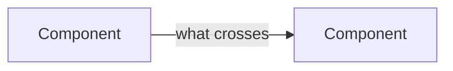

# Eng spec: <title>

Task: <PP-123 link>. One screen. Approved together with the product spec.

## Approach

<How it works, in one paragraph. Name the modules it adds or changes.>

## Shape

## Repos and PRs

| Repo | What changes | PR |
| ---- | ------------ | -- |
| <inspector / mcpjam-backend> | <one line> | <filled in at 06> |

## Decisions

| Decision | Choice | Why | Rejected |
| -------- | ------ | --- | -------- |
| <D1> | <choice> | <reason> | <alternative> |

## Risks

- <What could break, and how we would notice>
