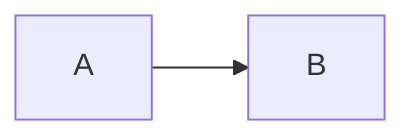
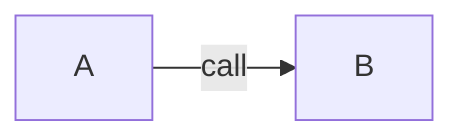

# <Title>: engineering spec

Task: <KEY and link> · Product spec: <link> · Status: draft | approved at revision <n>

## Summary

<About one screen: the approach, the repositories it touches and the one
risk a reviewer should look at first.>

## Architecture

Current:

Proposed:

## Affected repositories

| Repository | Change | Order |
| ---------- | ------ | ----- |

## Reuse and deletion

- Reused: <existing modules this builds on>
- Deleted: <code this removes, or the v1 a v2 replaces and when it goes>

## Interfaces

<Functions, endpoints, schemas and events that change, with their shapes.>

## Failure handling

<What fails, what the user sees, what is retried and what is logged.>

## Verification

<Tests and live checks, mapped to the acceptance scenarios.>

## Rollout

<Flags, migrations, deploy order across repositories, or "None: ships with
the deploy".>

## UI

<Link to the UI diff, or "None: no UI change.">
