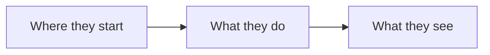

# Product spec: <title>

Task: <PP-123 link>. One screen. Approved together with the eng spec.

## Who and why

<The persona, the problem they have today, and the evidence for it. Two or three sentences.>

## What they can do after

- <Outcome, in the persona's words>
- <Outcome>

## Flow

## Done when

- <Checkable condition, including the error state>
- <Checkable condition>

## Not doing

- <What someone might expect that this leaves out>
