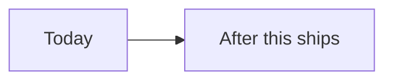

# <Title>: product spec

Task: <KEY and link> · Status: draft | approved at revision <n>

## Summary

<About one screen. Who this is for, what they can do afterwards that they
cannot today, and why now. Link detail instead of leaving out a decision.>

## Audience

<A named persona, such as "hosted evals user" or "org admin", and the
situation they are in.>

## Intended behavior

<What the user sees and does, step by step. Customer-visible choices only;
how it is built belongs in the engineering spec.>

## Non-goals

- <What this deliberately does not do, and why.>

## Acceptance scenarios

<Each one a reviewer can check without asking: [thing] [does / returns /
prevents] [behavior] [under condition]. Include the error path. These become
the acceptance evidence on the review page.>

1. ...

## Open decisions

| Decision | Options | Owner | Needed by |
| -------- | ------- | ----- | --------- |
