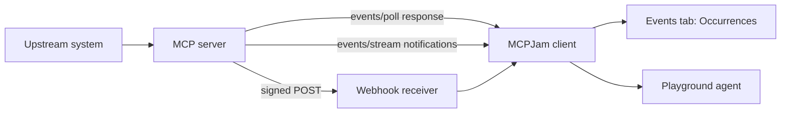
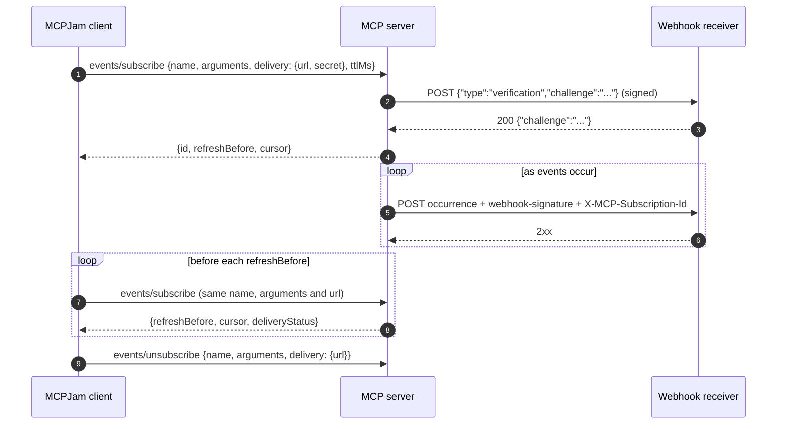

MCP Events lets a client subscribe to things that happen in an upstream system, such as a new comment, a GitHub push or a PagerDuty incident, and receive each one as it happens. An agent can then react without a user asking. The extension is `io.modelcontextprotocol/events`, defined by [SEP-3415](https://github.com/modelcontextprotocol/modelcontextprotocol/blob/main/seps/3415-events-extension.md) and currently in Beta. MCPJam follows the [Beta specification at `c77b843`](https://github.com/modelcontextprotocol/ext-events/blob/c77b84395eff0ae32f53b0516c2214fe276ed050/specification/beta/events/events.mdx).

This page explains how the extension works, then walks through testing a server's events in MCPJam: first in the Events tab, then with an agent in the Playground, then from the CLI for conformance and CI.

## How MCP Events works

A server lists its event types with `events/list`. Each event type has a `name`, an `inputSchema` for subscription arguments, a `payloadSchema` for the data it delivers, and a `delivery` list naming the modes it supports. A client subscribes with a name and arguments, and receives occurrences shaped like this:

```json
{
  "eventId": "evt_789",
  "name": "comment.created",
  "timestamp": "2026-11-25T16:00:00Z",
  "data": { "document_id": "doc_1", "comment_id": "c1", "text": "hi" },
  "cursor": "c17"
}
```

There are three delivery modes. The server advertises any non-empty subset of them per event type, and none is mandatory:

| Mode | How the client receives events | What the server keeps |
| --- | --- | --- |
| **Poll** | The client calls `events/poll` with the name, arguments and cursor, and waits `nextPollMs` between calls. The first poll, with `cursor: null`, starts the subscription from now. | Nothing. Each poll carries everything the server needs. |
| **Push** | The client holds one `events/stream` request open per subscription. The server confirms with `notifications/events/active`, then sends `notifications/events/event` and periodic heartbeats on it. | Only what the open request needs. Closing or cancelling it ends the subscription. |
| **Webhook** | The client calls `events/subscribe` with a callback URL and a signing secret. The server POSTs each occurrence to that URL, signed with [Standard Webhooks](https://github.com/standard-webhooks/standard-webhooks/blob/main/spec/standard-webhooks.md), and the client calls `events/subscribe` again before `refreshBefore` to keep it alive. | The subscription, until its TTL runs out or the client unsubscribes. |

The diagram shows the three paths and where MCPJam sits in each when it acts as the client:



The webhook receiver depends on where MCPJam runs. The hosted app registers MCPJam's public inbox at `https://hooks.mcpjam.com`, which checks each signature before it records the delivery. The local app and the CLI start a receiver on your machine, which a server can reach directly or through a tunnel.

A webhook subscription takes more steps than the other two modes, because the server must prove the callback URL wants its events and the client must keep the subscription alive:



Three ideas run through every mode:

- **Cursor.** An opaque position the client stores and sends back. `null` on a request means "start from now". A server that can replay uses the cursor to resend what the client missed. When the cursor has fallen outside what the server can replay, the server says so with `truncated: true` (poll and push) or a `gap` envelope (webhook) instead of failing.
- **Subscription key.** A webhook subscription is identified by the authenticated principal, the callback URL, the event name and the arguments. Calling `events/subscribe` again with the same four refreshes it. Changing any of them creates a different subscription. Webhook delivery therefore requires an authenticated connection.
- **Termination.** A server ends a subscription with `notifications/events/terminated` on a push stream or a `terminated` envelope to a webhook, for example when access is revoked or the event type is removed.

The Beta extension is defined for MCP protocol `2026-07-28` and later. The server declares it under `capabilities.extensions` in its `server/discover` response:

```json
{
  "capabilities": {
    "extensions": {
      "io.modelcontextprotocol/events": { "listChanged": true }
    }
  }
}
```

A client must not send `events/*` requests to a server that has not declared it. Every result carries `resultType: "complete"`, and errors use the codes `-32023` (NotFound) to `-32027` (CallbackEndpointError).

<Note>
  MCPJam also understands two earlier contracts that use a top-level `capabilities.events` instead: the [working-group draft at `28ec35e`](https://github.com/modelcontextprotocol/experimental-ext-triggers-events/blob/28ec35e905daa241f019981e2836b4a02f1c0368/docs/design-sketch-proposal.md) and [ChatGPT's MCP Events](https://developers.openai.com/plugins/build/mcp-events), which is webhook-only. MCPJam reads whichever one the server declares. The CLI's `--profile` flag selects one explicitly.
</Note>

## Before you start

- **A server that declares Events.** For the Beta extension, the server must answer `server/discover` on protocol `2026-07-28` with `io.modelcontextprotocol/events` in its capabilities. Make sure the connection negotiates that version; see [Protocol versions](/inspector/protocol-versions).
- **A way to make an event happen.** Usually a tool on the same server, such as `add_comment` for `comment.created`. You need it to see an occurrence arrive.
- **For webhook mode, a callback the server can reach.** The hosted app provides one. Locally, a server on your machine can call MCPJam directly. A remote server needs a public `https` URL, usually a tunnel, because conformant servers refuse plain `http` callbacks.
- **For the hosted app, a project.** Hosted subscriptions belong to a project, and the server must be added to it.

## Test events in the Events tab

<Frame>
  
</Frame>

<Steps>
  <Step title="Connect the server">
    Connect the server as usual from [Connect servers](/inspector/connecting-servers), then open the **Events** tab. If it shows **This server does not declare events**, the server's capabilities do not include the extension. Check the protocol version first: a server that only declares Events on `2026-07-28` will not show it on an older connection.
  </Step>
  <Step title="Check what the server declared">
    The capability panel shows **Events declared**, **Read from** (where MCPJam found the declaration, such as `server/discover`) and the negotiated **Protocol version**. If the server declared `listChanged: true`, MCPJam asks for `notifications/events/list_changed` and refreshes the list when one arrives. Use the refresh button in the sidebar to fetch `events/list` again by hand.
  </Step>
  <Step title="Choose an event type">
    The **Browse events** list holds every page of `events/list`. Select an event type to open its **Event type details**: the description, the delivery modes it advertises, and its `inputSchema` and `payloadSchema`. Compare them with what you meant to publish. A missing `payloadSchema` field or a mode you did not intend to offer is easier to fix now than after clients depend on it.
  </Step>
  <Step title="Fill in the parameters">
    Under **Parameters**, MCPJam builds a form from the event type's `inputSchema`. Switch to **Use JSON** to edit the arguments directly, for example to send a value the schema should reject and see whether the server refuses it with `InvalidParams`.
  </Step>
  <Step title="Choose a delivery mode">
    Under **Delivery**, pick **Poll**, **Push** or **Webhook**. A mode is available only when both the event type advertises it and the client you subscribe as accepts it.

    Locally, you subscribe as the Playground's active [client](/inspector/clients), and that client's protocol settings decide which modes it receives. If none of its modes match the event type, the panel says so and offers **Open Clients**. The hosted app subscribes as MCPJam itself and supports **Poll** and **Webhook**; push is available only in the local app for now.
  </Step>
  <Step title="Set the callback (webhook only)">
    In the hosted app there is nothing to set. Deliveries go to MCPJam's public inbox, which checks each signature.

    In the local app, choose a **Callback**:

    - **This machine** uses MCPJam's own address. It works when the server runs on the same machine or network, and it is plain `http`, so you must tick **Allow plain HTTP for local development**. A conformant server refuses this URL; use it to develop your delivery code, not to prove conformance.
    - **Custom URL** takes the public `https` address of your reverse proxy or tunnel, such as `https://your-tunnel.example.com/mcp-hooks`. MCPJam shows the **Proxy forwarding rule** to configure: forward everything under that prefix to MCPJam, keeping the path, body and webhook headers intact.

    Both choices also show the equivalent **CLI flags** for `mcpjam events watch`.
  </Step>
  <Step title="Adjust the advanced settings (optional)">
    **Advanced settings** exposes the request fields you may set under their spec names: `maxAgeMs` to limit replay, and for webhooks `ttlMs` (the suggested lifetime) and **No expiry** (`ttlMs: null`). MCPJam fills in `cursor`, `delivery.url` and `delivery.secret` itself. The local app suggests a 10-minute TTL; the server decides the actual lifetime, and MCPJam refreshes before `refreshBefore`.
  </Step>
  <Step title="Subscribe and make an event happen">
    Click **Subscribe**. For a webhook, the subscription shows a three-step checklist: **Subscribed** once the server accepts `events/subscribe`, **Server reached MCPJam** once its verification request or first delivery arrives, and **Events arriving** once deliveries are coming in without errors. A step that stays unchecked tells you which leg to debug.

    Now cause the event, for example by calling the trigger tool from the [Tools tab](/inspector/tools-prompts-resources#tools) or by acting in the upstream system. Each occurrence appears under **Occurrences** with its `eventId`, `timestamp`, `cursor` and `data`. Check that `data` matches the `payloadSchema` and that `eventId` stays the same if the same upstream event is delivered twice.

    <Frame>
      
    </Frame>
  </Step>
  <Step title="Manage the subscription">
    Select it under **Subscriptions** to see its delivery mode, client, cursor, `refreshBefore`, server subscription id and the server's `deliveryStatus` (`lastDeliveryAt`, `lastError`, `failedSince`). From there you can:

    - **Pause** it, which unsubscribes from the server while keeping the subscription, and **Resume** it.
    - **Rotate secret** (webhook only). MCPJam refreshes the subscription with a new secret. The hosted inbox keeps accepting the old secret for a short overlap, so deliveries already in flight still verify.
    - **Reauthorize** a hosted subscription that stopped because its credentials were rejected (`paused_auth`).
  </Step>
</Steps>

## Test how an agent reacts

The Events tab tells you whether the protocol works. The Playground tells you whether an agent does something sensible with what arrives.

<Steps>
  <Step title="Connect an event to the conversation">
    In the [Playground](/inspector/playground), open the **Events** tab in the left rail and click **Connect event**. Choose an event type from your connected servers, fill in its parameters, and write the **Instructions**: what the agent should do when this event arrives. While the Playground is open, each occurrence runs the agent in this conversation. The server subscription also appears in the Events tab.
  </Step>
  <Step title="Send test data">
    Click **Trigger event** on the connected event and enter a JSON object for `data`. MCPJam runs it as a Playground message, so you can iterate on the instructions without touching the server. This does not emit an event from your server.
  </Step>
  <Step title="Send a real event">
    Cause the event on the server, as in the previous section. The agent runs with the occurrence as untrusted context, never as instructions. Watch which tools it calls and whether it follows your instructions.
  </Step>
  <Step title="Let the agent subscribe itself">
    Ask the agent in plain words, for example "tell me when someone comments on doc_1". The Playground gives the model five tools for this: `mcpjam_list_event_types`, `mcpjam_subscribe_to_events`, `mcpjam_update_event_subscription`, `mcpjam_list_event_subscriptions` and `mcpjam_delete_event_subscription`. A subscription the agent creates is the same object as one you connect by hand, and its arguments are checked against the event type's `inputSchema` before MCPJam contacts the server. Use this to check that your event names, descriptions and `inputSchema` are clear enough for a model to pick the right event and arguments.
  </Step>
</Steps>

## Check conformance from the CLI

The Events tab shows what happened. The `mcpjam events conformance` command checks the server against the specification and gives a pass or fail you can run in CI:

```bash
mcpjam events conformance \
  --url https://your-server.com/mcp \
  --event-args 'comment.created={"document_id":"doc_1"}' \
  --public-url https://your-tunnel.example.com \
  --trigger-tool add_comment --trigger-args '{"document_id":"doc_1","text":"hi"}'
```

Without a receiver flag, the capability, list, poll and subscribe-refusal checks still run, and the webhook delivery checks report `could-not-run`. Without `--trigger-tool`, nothing causes a delivery, so the signature and header checks cannot run either. The run is then `incomplete` (exit `3`) rather than a pass.

[MCP Events in the CLI](/cli/events) covers every command: `list`, `poll`, `watch` in each delivery mode, `subscribe` and `unsubscribe` for a receiver you run yourself, `conformance`, and the error codes.

## What to verify

| Behavior the specification requires | Where to see it |
| --- | --- |
The ids in the right column are `mcpjam events conformance` checks. Run one with `--checks <id>`.

| Behavior the specification requires | Where to see it |
| --- | --- |
| The extension is declared under `capabilities.extensions` on `2026-07-28` | Events tab capability panel; `mcpjam events list`; `events-capability-declared` |
| `events/list` results have the defined shape and every `delivery` list is non-empty | **Browse events**; `events-list-shape` |
| A poll with `cursor: null` returns no events and a fresh cursor | `mcpjam events poll`; `events-poll-null-cursor` |
| A push stream confirms with `notifications/events/active` and sends heartbeats | Push subscription in the Events tab; `mcpjam events watch --mode push`; `events-push-heartbeat` (off by default, waits 65 s) |
| `events/subscribe` rejects a plain `http` callback and a malformed secret | `events-subscribe-rejects-http-callback`, `events-subscribe-rejects-invalid-secret` |
| Subscribing again with the same key refreshes instead of duplicating | `events-subscribe-idempotent` |
| The server verifies the callback before it delivers | **Server reached MCPJam** in the webhook checklist; `events-receiver-consent` |
| Every delivery is signed and carries `X-MCP-Subscription-Id` | **Subscription mismatch** flags in Occurrences; `events-delivery-signature`, `events-subscription-id-header` (need `--trigger-tool`) |
| `data` matches `payloadSchema` | **Occurrences**: deliveries that do not match are flagged **Quarantined** and run nothing |
| Unsubscribing twice is harmless | `mcpjam events unsubscribe`; `events-unsubscribe-twice` |

## Troubleshooting

**This server does not declare events.** MCPJam sends no `events/*` request to a server that has not declared the extension. Confirm the declaration is in `server/discover` and that the connection negotiated `2026-07-28`.

**No delivery mode can be selected.** Either the event type does not advertise a mode the client accepts, or the client's protocol settings turn off the modes the event offers. Pick another client or change its settings in [Clients](/inspector/clients). In the hosted app, an event type that offers only push cannot be subscribed yet; use the local app.

**A webhook subscription stays in Subscribing.** The server could not reach the callback or the verification failed. A server that refuses `http` will never accept **This machine**; use **Custom URL** with an `https` tunnel. Check that the tunnel forwards the full path and the `webhook-*` headers.

**Occurrences show Subscription mismatch.** The server sent an `X-MCP-Subscription-Id` different from the `id` it returned from `events/subscribe`. MCPJam still records the event. The server should derive the id deterministically from the principal, callback URL, name and arguments.

**A gap or truncated entry appears.** The server could not replay everything since the stored cursor and sent a fresh one. This is how the specification reports lost history, not an error. If it happens on every reconnect, check that the server honours the cursor it hands out.
