# Representative observed errors and fixes

Rendered evidence from captured output; no native terminal photographs. These are observed output classes, not an exhaustive state-space inventory. Successful documentation/help examples do not create error classes. Every detected event is listed in [error-gallery.json](error-gallery.json); every command outcome remains in the [complete evidence index](../index.md). Attribution is separate from the observed error.

## Before/after product reproductions

These controlled reproductions demonstrate changed output. Fresh-user improvement is assessed separately in the [comparison](../comparison/index.md).

### Actionable usage errors

Before: [complete stdout](../preflight/product-fixes--before-link-usage/stdout.txt) · [stderr](../preflight/product-fixes--before-link-usage/stderr.txt)

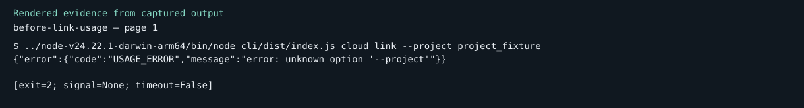

After: [complete stdout](../preflight/product-fixes--after-link-usage/stdout.txt) · [stderr](../preflight/product-fixes--after-link-usage/stderr.txt)

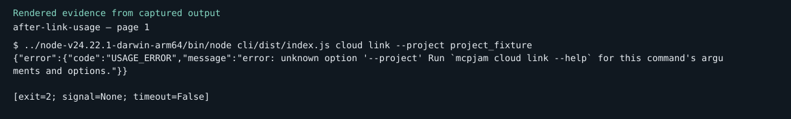

### Discoverable credit/cost limits in Eval help

Before: [complete stdout](../preflight/product-fixes--before-eval-help/stdout.txt) · [stderr](../preflight/product-fixes--before-eval-help/stderr.txt)

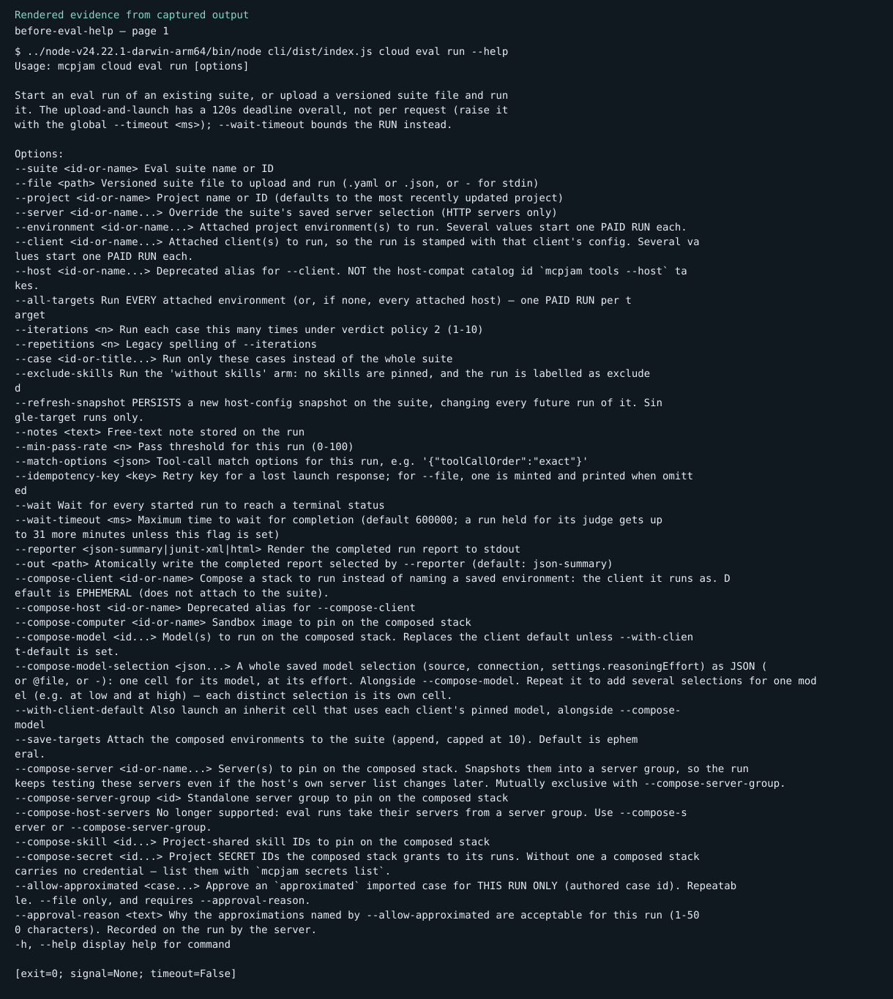

After: [complete stdout](../preflight/product-fixes--after-eval-help/stdout.txt) · [stderr](../preflight/product-fixes--after-eval-help/stderr.txt)

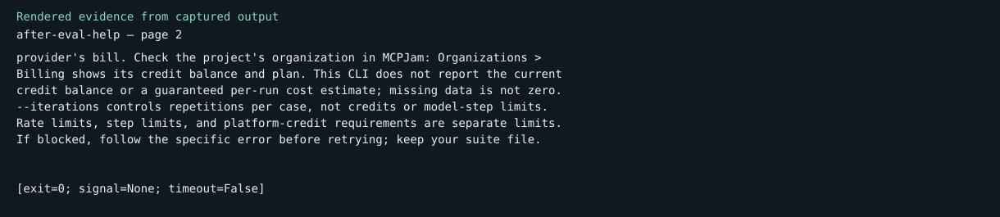

### Plan/role-aware platform-credit recovery guidance

Before: [complete stdout](../preflight/product-fixes--before-platform-fee-message/stdout.txt) · [stderr](../preflight/product-fixes--before-platform-fee-message/stderr.txt)

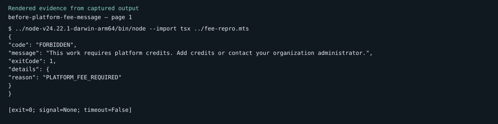

After: [complete stdout](../preflight/product-fixes--after-platform-fee-corrected/stdout.txt) · [stderr](../preflight/product-fixes--after-platform-fee-corrected/stderr.txt)

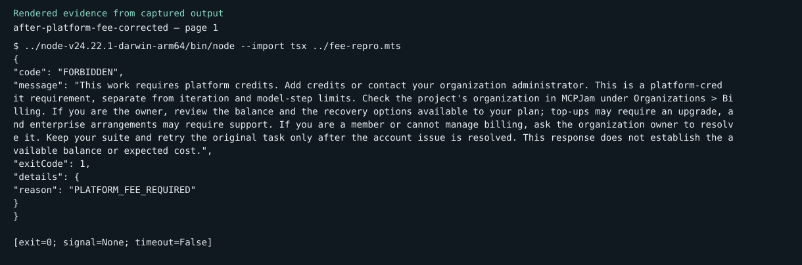

### GET405 HTTP body excluded from JSON-RPC schema checks

Before: [complete stdout](../preflight/product-fixes--before-conformance-get405/stdout.txt) · [stderr](../preflight/product-fixes--before-conformance-get405/stderr.txt)

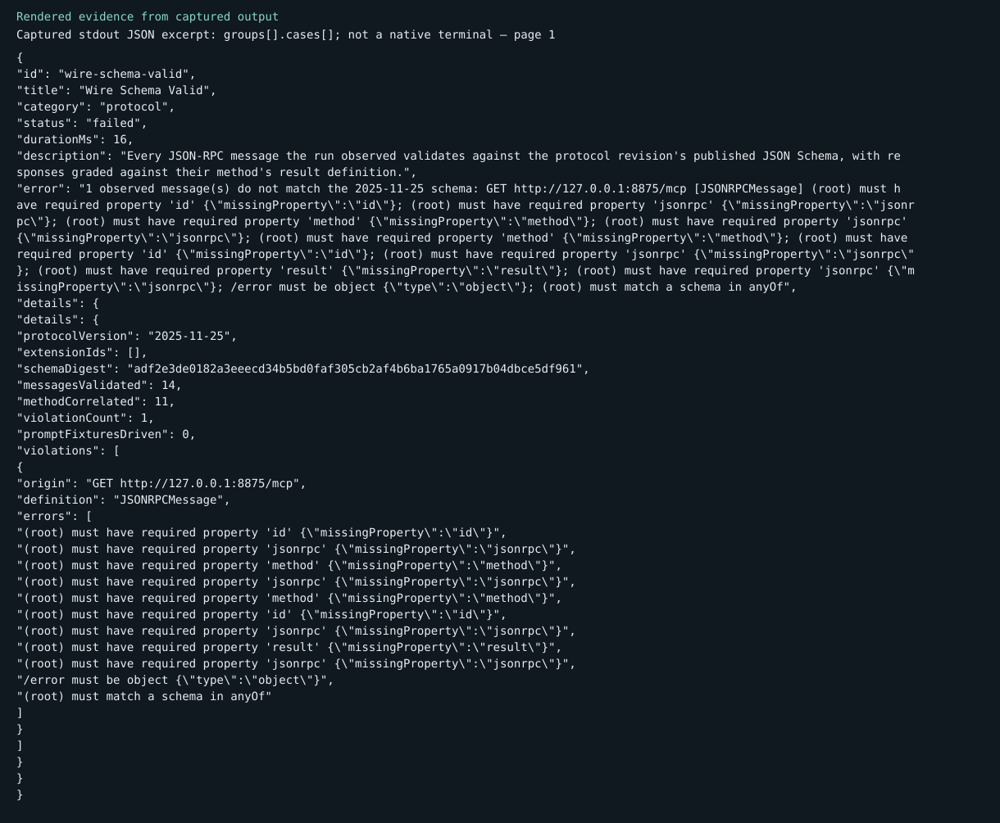

After: [complete stdout](../preflight/product-fixes--after-conformance-get405/stdout.txt) · [stderr](../preflight/product-fixes--after-conformance-get405/stderr.txt)

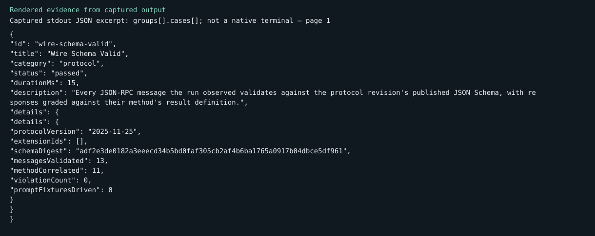

## Observed command error classes

### CLI_USAGE_TEXT

orchestrator/product reproduction.

[preflight / product-fixes:before-link-usage](../preflight/product-fixes--before-link-usage/event.json) · [stdout](../preflight/product-fixes--before-link-usage/stdout.txt) · [stderr](../preflight/product-fixes--before-link-usage/stderr.txt)

### CONFORMANCE:localhost-host-rebinding-rejected

observed conformance check failure; inspect fixture and checker evidence before attribution.

[preflight / product-fixes:after-conformance-get405](../preflight/product-fixes--after-conformance-get405/event.json) · [stdout](../preflight/product-fixes--after-conformance-get405/stdout.txt) · [stderr](../preflight/product-fixes--after-conformance-get405/stderr.txt)

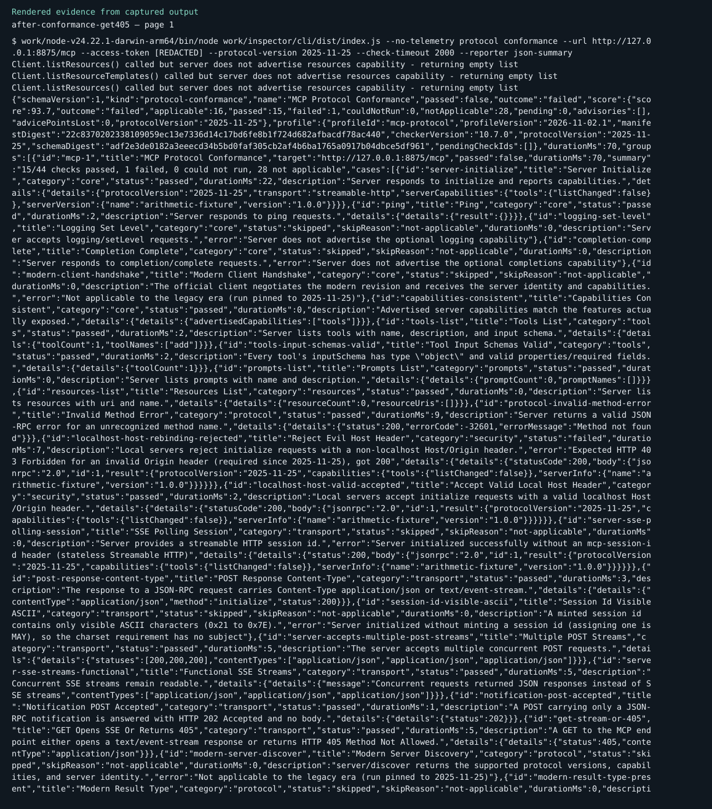
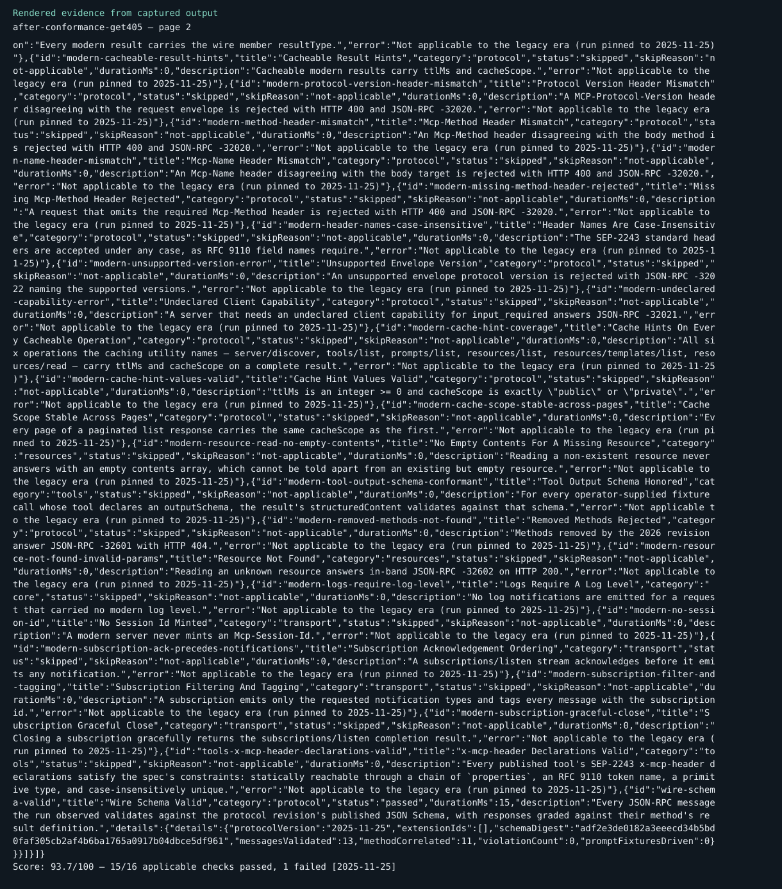
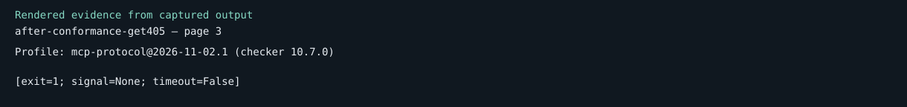

### CONFORMANCE:wire-schema-valid

conformance checker; GET405 false positive confirmed by controlled reproduction, other contexts require inspection.

[patched-auth-v13--auth__GiXEbFi / 4caa7eee610d4d5582e79f80506da13d](../patched-auth-v13--auth__GiXEbFi/commands/0018-4caa7eee610d4d5582e79f80506da13d/event.json) · [stdout](../patched-auth-v13--auth__GiXEbFi/commands/0018-4caa7eee610d4d5582e79f80506da13d/stdout.txt) · [stderr](../patched-auth-v13--auth__GiXEbFi/commands/0018-4caa7eee610d4d5582e79f80506da13d/stderr.txt)

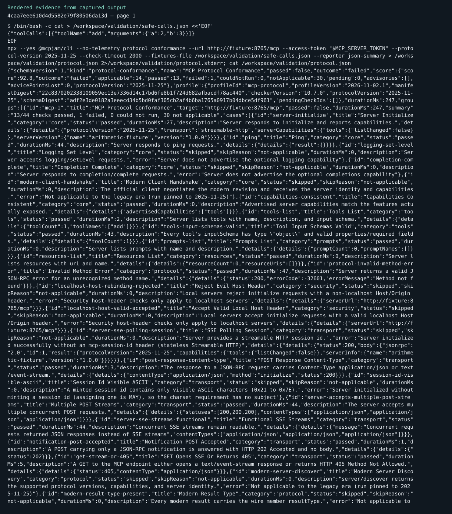
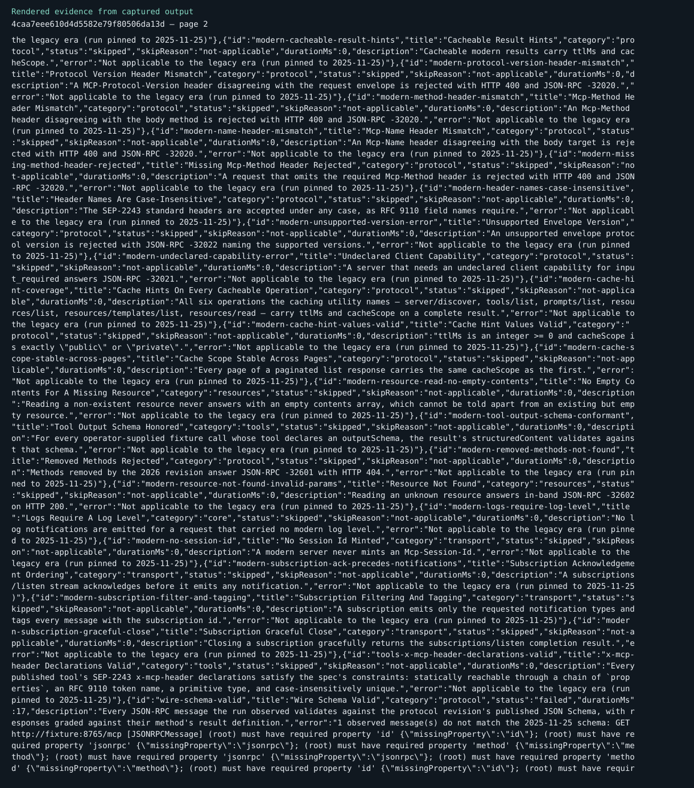
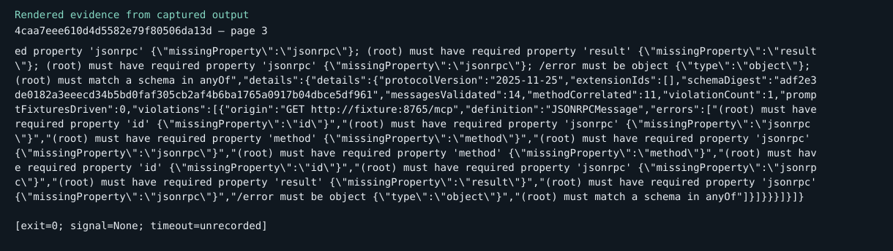

### CREDENTIALS_MISSING

unattributed; inspect linked command output.

[baseline-priority-v13--healthy__9e6btMY / 55a312a7ba8e42cf8c575f26fee8a949](../baseline-priority-v13--healthy__9e6btMY/commands/0007-55a312a7ba8e42cf8c575f26fee8a949/event.json) · [stdout](../baseline-priority-v13--healthy__9e6btMY/commands/0007-55a312a7ba8e42cf8c575f26fee8a949/stdout.txt) · [stderr](../baseline-priority-v13--healthy__9e6btMY/commands/0007-55a312a7ba8e42cf8c575f26fee8a949/stderr.txt)

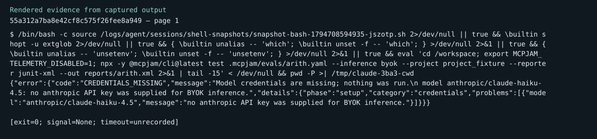

### CREDENTIALS_REJECTED

unattributed; inspect linked command output.

[baseline-codex-healthy-v1--smoke-healthy-v1__Z4eU7EV / 004ddd416d654c09b26d74c6b6103925](../baseline-codex-healthy-v1--smoke-healthy-v1__Z4eU7EV/commands/0001-004ddd416d654c09b26d74c6b6103925/event.json) · [stdout](../baseline-codex-healthy-v1--smoke-healthy-v1__Z4eU7EV/commands/0001-004ddd416d654c09b26d74c6b6103925/stdout.txt) · [stderr](../baseline-codex-healthy-v1--smoke-healthy-v1__Z4eU7EV/commands/0001-004ddd416d654c09b26d74c6b6103925/stderr.txt)

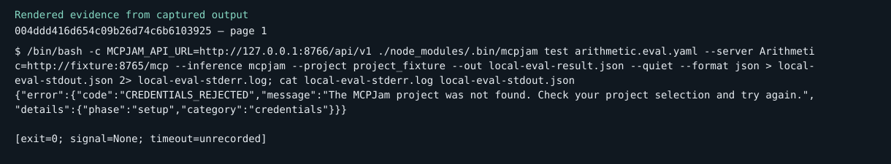

### FEATURE_NOT_SUPPORTED:fixture_unsupported_execution

fixture limitation.

[baseline-six-v12--healthy__dyyzkKT / 91c71adbe58b4b4ca34598940f2dc65f](../baseline-six-v12--healthy__dyyzkKT/commands/0034-91c71adbe58b4b4ca34598940f2dc65f/event.json) · [stdout](../baseline-six-v12--healthy__dyyzkKT/commands/0034-91c71adbe58b4b4ca34598940f2dc65f/stdout.txt) · [stderr](../baseline-six-v12--healthy__dyyzkKT/commands/0034-91c71adbe58b4b4ca34598940f2dc65f/stderr.txt)

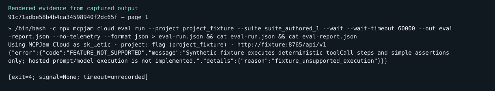

### FORBIDDEN:PLATFORM_FEE_REQUIRED

product CLI adapter reproduction with synthetic input.

[preflight / product-fixes:before-platform-fee-esm](../preflight/product-fixes--before-platform-fee-esm/event.json) · [stdout](../preflight/product-fixes--before-platform-fee-esm/stdout.txt) · [stderr](../preflight/product-fixes--before-platform-fee-esm/stderr.txt)

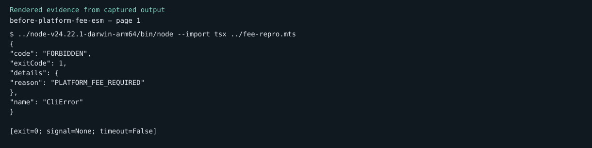

### INTERNAL_ERROR

unattributed; inspect linked command output.

[patched-priority-v13--healthy__Am8udgv / dd78d0b2a1404acb9f1d5b8de4610061](../patched-priority-v13--healthy__Am8udgv/commands/0060-dd78d0b2a1404acb9f1d5b8de4610061/event.json) · [stdout](../patched-priority-v13--healthy__Am8udgv/commands/0060-dd78d0b2a1404acb9f1d5b8de4610061/stdout.txt) · [stderr](../patched-priority-v13--healthy__Am8udgv/commands/0060-dd78d0b2a1404acb9f1d5b8de4610061/stderr.txt)

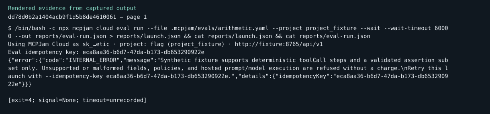

### MCP_TOOL_ERROR

fixture tool result; not a product failure by itself.

[baseline-six-v12--auth__Tx2qPDy / 10ed5d60597c473f80841b0be9ab1219](../baseline-six-v12--auth__Tx2qPDy/commands/0004-10ed5d60597c473f80841b0be9ab1219/event.json) · [stdout](../baseline-six-v12--auth__Tx2qPDy/commands/0004-10ed5d60597c473f80841b0be9ab1219/stdout.txt) · [stderr](../baseline-six-v12--auth__Tx2qPDy/commands/0004-10ed5d60597c473f80841b0be9ab1219/stderr.txt)

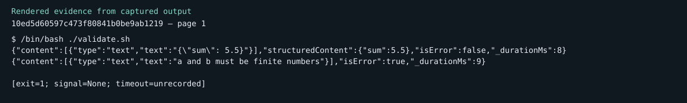

### MISSING_COMMAND_OR_FILE

tester command/environment; causality requires review.

[baseline-priority-v13--healthy__YYqEMAi / 6a250761d6c14c98aa240f772716ec15](../baseline-priority-v13--healthy__YYqEMAi/commands/0016-6a250761d6c14c98aa240f772716ec15/event.json) · [stdout](../baseline-priority-v13--healthy__YYqEMAi/commands/0016-6a250761d6c14c98aa240f772716ec15/stdout.txt) · [stderr](../baseline-priority-v13--healthy__YYqEMAi/commands/0016-6a250761d6c14c98aa240f772716ec15/stderr.txt)

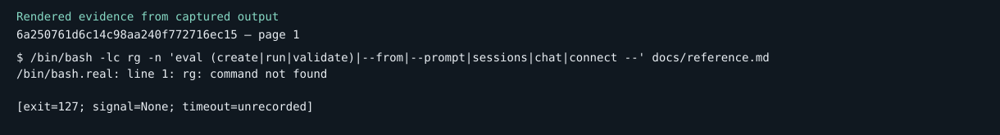

### NOT_FOUND

unattributed; inspect linked command output.

[baseline-codex-healthy-v1--smoke-healthy-v1__Z4eU7EV / 210644dd352a457aa043e22fcdb492f8](../baseline-codex-healthy-v1--smoke-healthy-v1__Z4eU7EV/commands/0015-210644dd352a457aa043e22fcdb492f8/event.json) · [stdout](../baseline-codex-healthy-v1--smoke-healthy-v1__Z4eU7EV/commands/0015-210644dd352a457aa043e22fcdb492f8/stdout.txt) · [stderr](../baseline-codex-healthy-v1--smoke-healthy-v1__Z4eU7EV/commands/0015-210644dd352a457aa043e22fcdb492f8/stderr.txt)

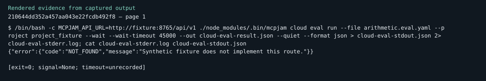

### OAUTH_REQUIRED

unattributed; inspect linked command output.

[patched-cycle2-auth-v13--auth__MV27c9o / c5495ba3f82d45908498c214fb363ef2](../patched-cycle2-auth-v13--auth__MV27c9o/commands/0051-c5495ba3f82d45908498c214fb363ef2/event.json) · [stdout](../patched-cycle2-auth-v13--auth__MV27c9o/commands/0051-c5495ba3f82d45908498c214fb363ef2/stdout.txt) · [stderr](../patched-cycle2-auth-v13--auth__MV27c9o/commands/0051-c5495ba3f82d45908498c214fb363ef2/stderr.txt)

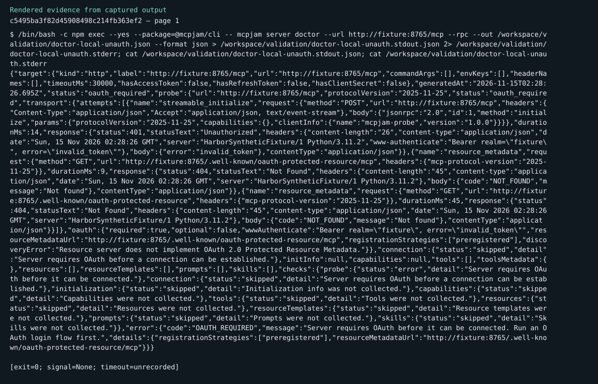

### OPTIONS_INVALID

unattributed; inspect linked command output.

[baseline-six-v11--v11-credits__rRzz8xe / f88cfa964ae7478186e3661434e79c7b](../baseline-six-v11--v11-credits__rRzz8xe/commands/0026-f88cfa964ae7478186e3661434e79c7b/event.json) · [stdout](../baseline-six-v11--v11-credits__rRzz8xe/commands/0026-f88cfa964ae7478186e3661434e79c7b/stdout.txt) · [stderr](../baseline-six-v11--v11-credits__rRzz8xe/commands/0026-f88cfa964ae7478186e3661434e79c7b/stderr.txt)

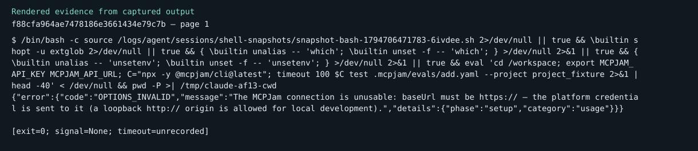

### UNCLASSIFIED_NONZERO_EXIT

unattributed; inspect linked command output.

[baseline-auth-v13--auth__DebKeUR / 392c690bd7614d6e93a039253b932011](../baseline-auth-v13--auth__DebKeUR/commands/0013-392c690bd7614d6e93a039253b932011/event.json) · [stdout](../baseline-auth-v13--auth__DebKeUR/commands/0013-392c690bd7614d6e93a039253b932011/stdout.txt) · [stderr](../baseline-auth-v13--auth__DebKeUR/commands/0013-392c690bd7614d6e93a039253b932011/stderr.txt)

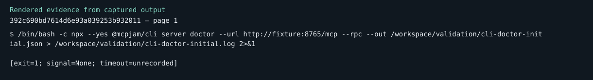

### USAGE_ERROR

orchestrator/product reproduction.

[preflight / product-fixes:before-link-usage](../preflight/product-fixes--before-link-usage/event.json) · [stdout](../preflight/product-fixes--before-link-usage/stdout.txt) · [stderr](../preflight/product-fixes--before-link-usage/stderr.txt)

Harbor, verifier, cancellation and timeout result exceptions

Harbor can exit zero while a trial fails. These screenshots render captured result metadata, not terminal output.

### Preflight: ENVIRONMENT_PERMISSION

[bootstrap:baseline-pack](../preflight/bootstrap--baseline-pack/event.json) · [stdout](../preflight/bootstrap--baseline-pack/stdout.txt) · [stderr](../preflight/bootstrap--baseline-pack/stderr.txt)

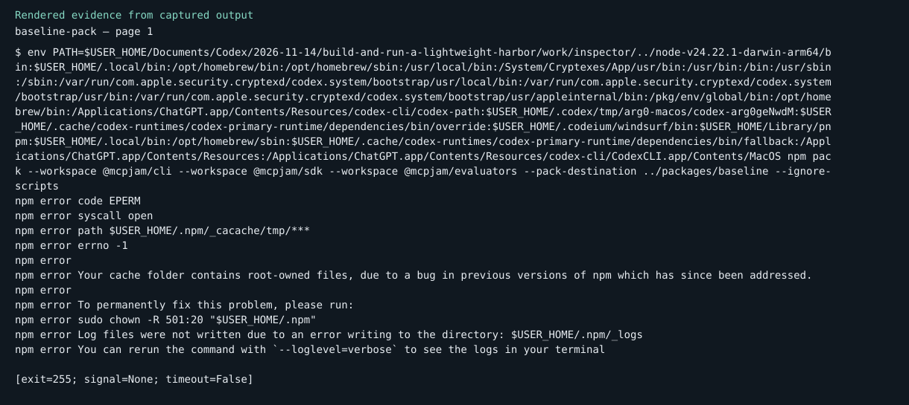

### AgentTimeoutError

[baseline-six-v11--v11-healthy__3YCuNWF / trial](../baseline-six-v11--v11-healthy__3YCuNWF/result.json)

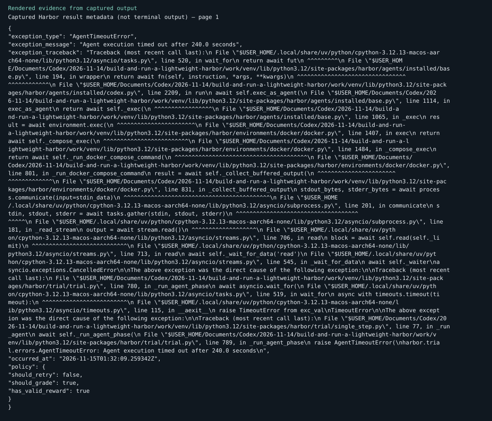

### CancelledError

[baseline-priority-v12--healthy__ApzP8X2 / trial](../baseline-priority-v12--healthy__ApzP8X2/result.json)

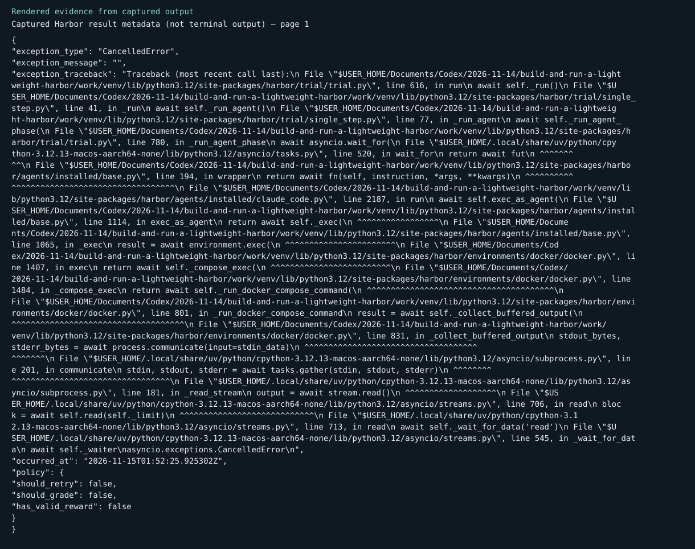

### RewardFileNotFoundError

[baseline-claude-auth-v11--baseline-auth-v11__bVF8dkf / trial](../baseline-claude-auth-v11--baseline-auth-v11__bVF8dkf/result.json)

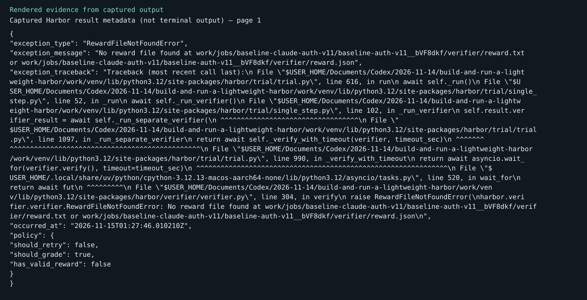

### RuntimeError

[baseline-codex-healthy-smoke--smoke-healthy__esC2H66 / trial](../baseline-codex-healthy-smoke--smoke-healthy__esC2H66/result.json)

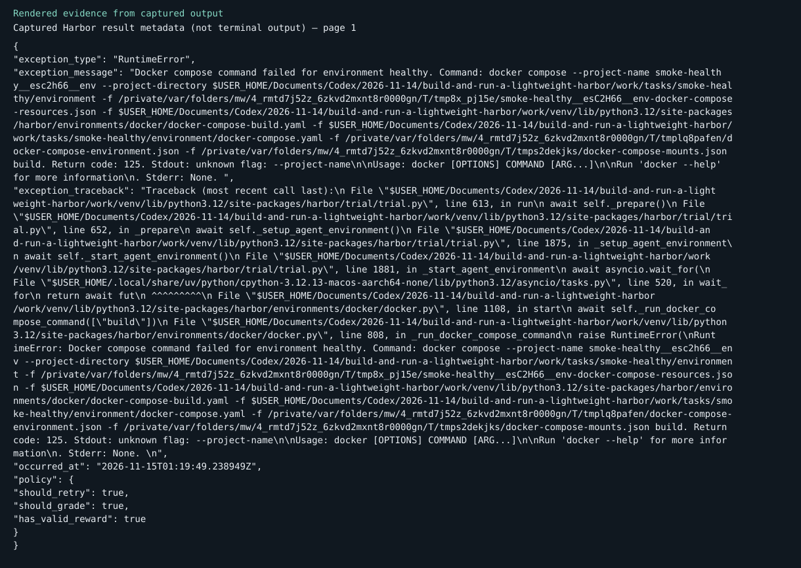

### UnknownApiError

[baseline-auth-v13--auth__HzCGt8k / trial](../baseline-auth-v13--auth__HzCGt8k/result.json)

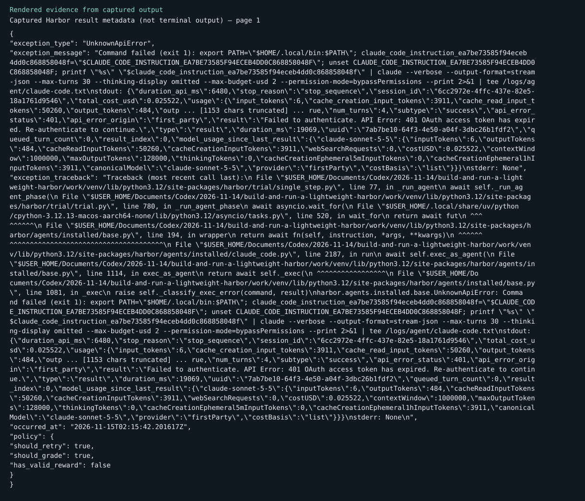

Unclassified nonzero exits are retained for manual review; the detector makes no claim that different messages within that bucket share a cause.
