# patched-auth-v13--auth__GiXEbFi

Outcome: **passed**. Concern notes: 0. Shell capture events: 56; actual agent shell invocations: 19.

[Results](result.json) · [Metrics](metrics.json) · [Concerns](concerns.jsonl) · [Agent tool invocations](agent-tool-invocations.json)

Capture events include nested wrapper shells and are not a user-command denominator. Legacy verifier `command_count` is also a capture-event count.

The outcome above reflects Harbor errors and the frozen strict reward. A zero reward alone does not establish a product failure.

- Assessment flag: `simulated_eval_observed_but_strict_command_match_missing`

## Public agent messages and tools

Private reasoning is omitted from these projections.

- [public-agent-codex.txt.jsonl](public-agent-codex.txt.jsonl)

## Collected artifacts

[Complete artifact inventory](artifact-inventory.json)

- [artifacts/fixture/state.json](artifacts/artifacts/fixture/state.json)
- [artifacts/workspace/mcp.json](artifacts/artifacts/workspace/mcp.json)
- [artifacts/workspace/validation/run-status-1.json](artifacts/artifacts/workspace/validation/run-status-1.json)
- [artifacts/workspace/validation/add-smoke.json](artifacts/artifacts/workspace/validation/add-smoke.json)
- [artifacts/workspace/validation/trace.json](artifacts/artifacts/workspace/validation/trace.json)
- [artifacts/workspace/validation/project-status.json](artifacts/artifacts/workspace/validation/project-status.json)
- [artifacts/workspace/validation/positive.json](artifacts/artifacts/workspace/validation/positive.json)
- [artifacts/workspace/validation/safe-calls.json](artifacts/artifacts/workspace/validation/safe-calls.json)
- [artifacts/workspace/validation/tool-checks.stdout.json](artifacts/artifacts/workspace/validation/tool-checks.stdout.json)
- [artifacts/workspace/validation/negative.json](artifacts/artifacts/workspace/validation/negative.json)
- [artifacts/workspace/validation/project-capabilities.json](artifacts/artifacts/workspace/validation/project-capabilities.json)
- [artifacts/workspace/validation/doctor-initial.stdout.json](artifacts/artifacts/workspace/validation/doctor-initial.stdout.json)
- [artifacts/workspace/validation/run-initial.json](artifacts/artifacts/workspace/validation/run-initial.json)
- [artifacts/workspace/validation/REPORT.md](artifacts/artifacts/workspace/validation/REPORT.md)
- [artifacts/workspace/validation/zero.json](artifacts/artifacts/workspace/validation/zero.json)
- [artifacts/workspace/validation/evals.json](artifacts/artifacts/workspace/validation/evals.json)
- [artifacts/workspace/validation/tool-checks.json](artifacts/artifacts/workspace/validation/tool-checks.json)
- [artifacts/workspace/validation/get-response.json](artifacts/artifacts/workspace/validation/get-response.json)
- [artifacts/workspace/validation/steps.json](artifacts/artifacts/workspace/validation/steps.json)
- [artifacts/workspace/validation/missing.json](artifacts/artifacts/workspace/validation/missing.json)
- [artifacts/workspace/validation/extra-property.json](artifacts/artifacts/workspace/validation/extra-property.json)
- [artifacts/workspace/validation/decimal.json](artifacts/artifacts/workspace/validation/decimal.json)
- [artifacts/workspace/validation/reproduce.sh](artifacts/artifacts/workspace/validation/reproduce.sh)
- [artifacts/workspace/validation/doctor-authenticated.stdout.json](artifacts/artifacts/workspace/validation/doctor-authenticated.stdout.json)
- [artifacts/workspace/validation/protocol.json](artifacts/artifacts/workspace/validation/protocol.json)
- [artifacts/workspace/validation/wrong-type.json](artifacts/artifacts/workspace/validation/wrong-type.json)
- [artifacts/workspace/validation/doctor-initial.json](artifacts/artifacts/workspace/validation/doctor-initial.json)
- [artifacts/workspace/validation/cli-version.txt](artifacts/artifacts/workspace/validation/cli-version.txt)
- [artifacts/workspace/validation/doctor-authenticated.json](artifacts/artifacts/workspace/validation/doctor-authenticated.json)
- [artifacts/workspace/validation/iterations.json](artifacts/artifacts/workspace/validation/iterations.json)

## 026a777ae8bd4bac93a23155af9802ff

Exit: `0`. Complete: `True`.

[Metadata](commands/0001-026a777ae8bd4bac93a23155af9802ff/event.json) · [stdout](commands/0001-026a777ae8bd4bac93a23155af9802ff/stdout.txt) · [stderr](commands/0001-026a777ae8bd4bac93a23155af9802ff/stderr.txt) · [ordered recording](commands/0001-026a777ae8bd4bac93a23155af9802ff/stream.jsonl)

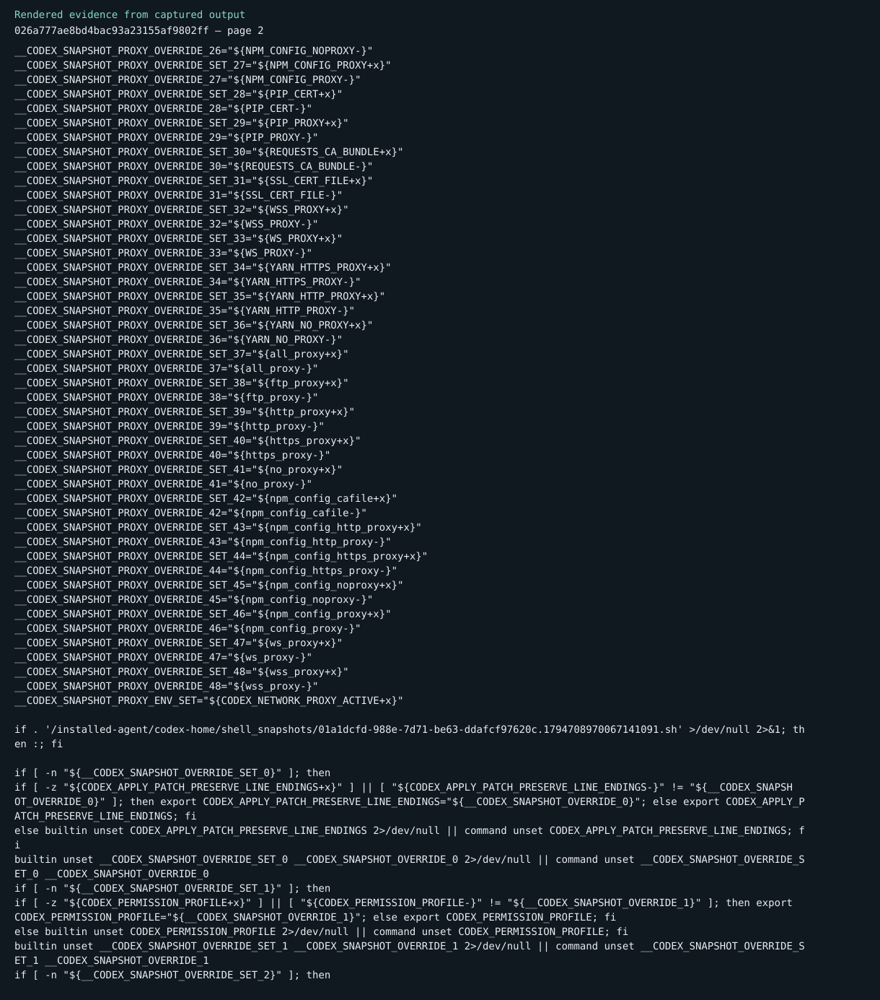

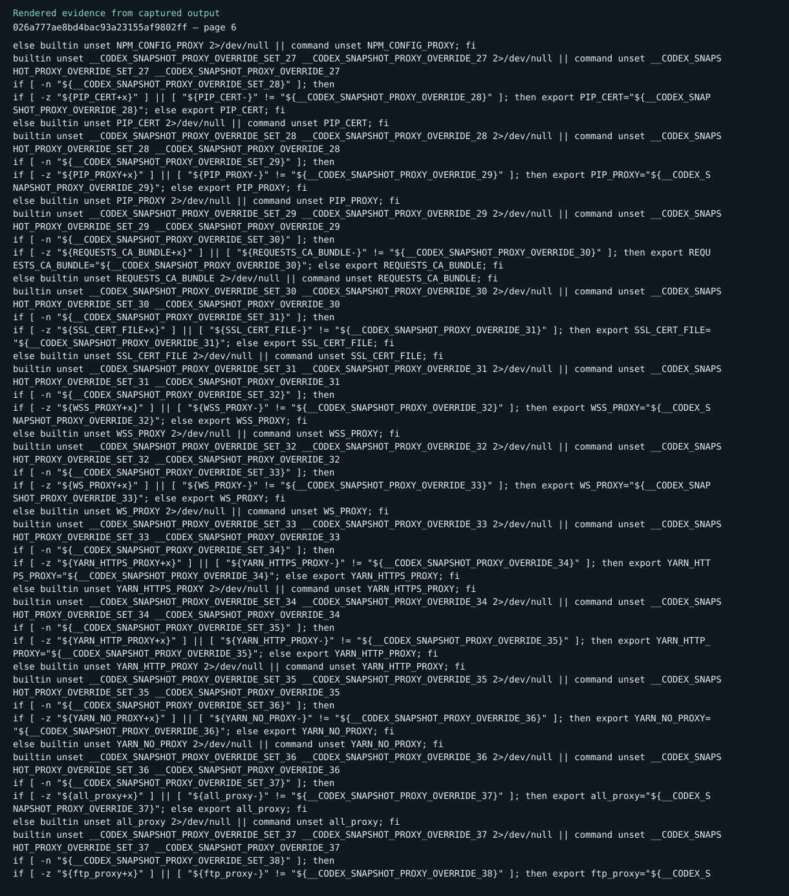

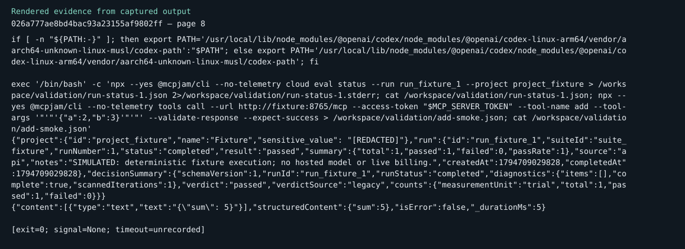
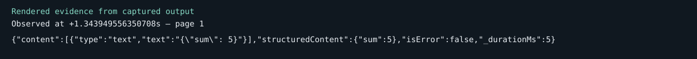

## 0a0a6dd8cda947e8a6881a03f833c46d

Exit: `1`. Complete: `True`.

[Metadata](commands/0002-0a0a6dd8cda947e8a6881a03f833c46d/event.json) · [stdout](commands/0002-0a0a6dd8cda947e8a6881a03f833c46d/stdout.txt) · [stderr](commands/0002-0a0a6dd8cda947e8a6881a03f833c46d/stderr.txt) · [ordered recording](commands/0002-0a0a6dd8cda947e8a6881a03f833c46d/stream.jsonl)

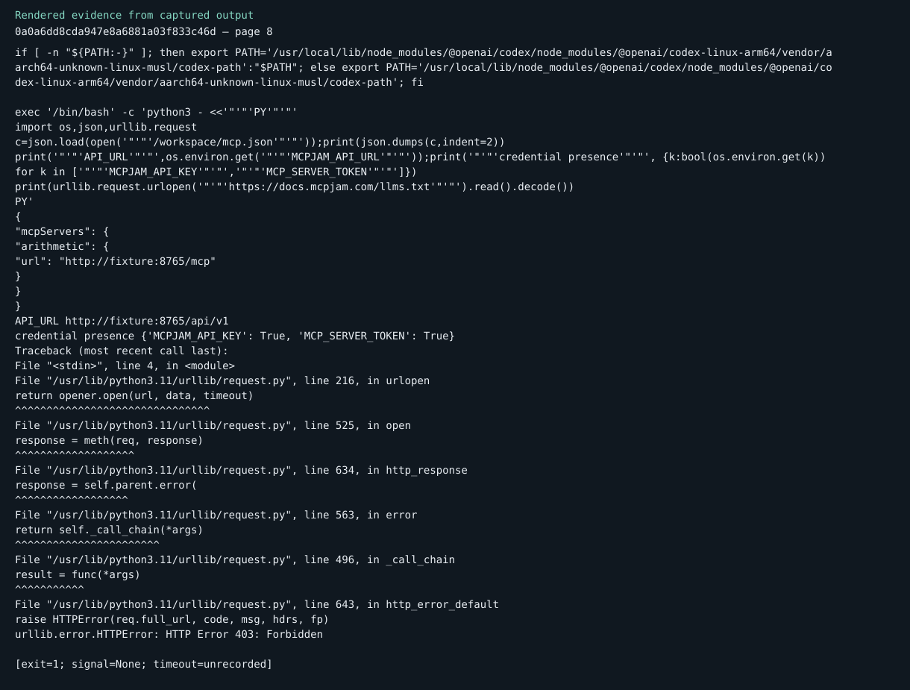
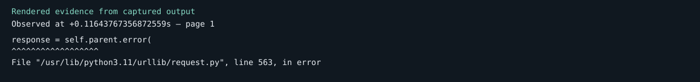
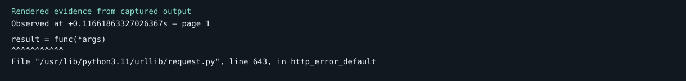
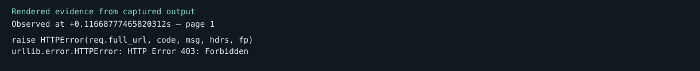

## 0cbb6a7136e545b39ad5392392ff0f06

Exit: `0`. Complete: `True`.

[Metadata](commands/0003-0cbb6a7136e545b39ad5392392ff0f06/event.json) · [stdout](commands/0003-0cbb6a7136e545b39ad5392392ff0f06/stdout.txt) · [stderr](commands/0003-0cbb6a7136e545b39ad5392392ff0f06/stderr.txt) · [ordered recording](commands/0003-0cbb6a7136e545b39ad5392392ff0f06/stream.jsonl)

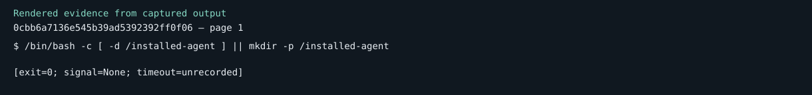

## 12aa94f498c94d34bdd6931a1cb4d07e

Exit: `0`. Complete: `True`.

[Metadata](commands/0004-12aa94f498c94d34bdd6931a1cb4d07e/event.json) · [stdout](commands/0004-12aa94f498c94d34bdd6931a1cb4d07e/stdout.txt) · [stderr](commands/0004-12aa94f498c94d34bdd6931a1cb4d07e/stderr.txt) · [ordered recording](commands/0004-12aa94f498c94d34bdd6931a1cb4d07e/stream.jsonl)

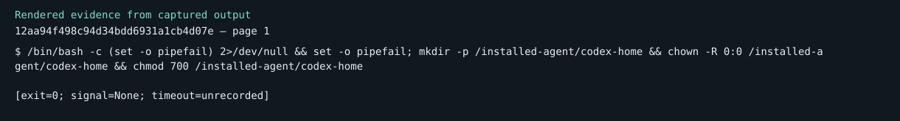

## 14e92ba8bb9f4dba85e5235c786d8937

Exit: `0`. Complete: `True`.

[Metadata](commands/0005-14e92ba8bb9f4dba85e5235c786d8937/event.json) · [stdout](commands/0005-14e92ba8bb9f4dba85e5235c786d8937/stdout.txt) · [stderr](commands/0005-14e92ba8bb9f4dba85e5235c786d8937/stderr.txt) · [ordered recording](commands/0005-14e92ba8bb9f4dba85e5235c786d8937/stream.jsonl)

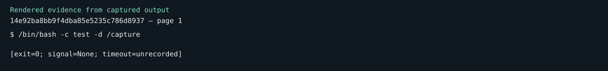

## 1501321cc05d4ae488ba5c6dcf46cb5f

Exit: `0`. Complete: `True`.

[Metadata](commands/0006-1501321cc05d4ae488ba5c6dcf46cb5f/event.json) · [stdout](commands/0006-1501321cc05d4ae488ba5c6dcf46cb5f/stdout.txt) · [stderr](commands/0006-1501321cc05d4ae488ba5c6dcf46cb5f/stderr.txt) · [ordered recording](commands/0006-1501321cc05d4ae488ba5c6dcf46cb5f/stream.jsonl)

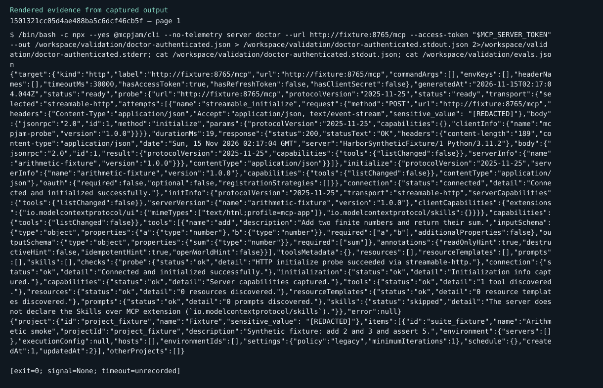
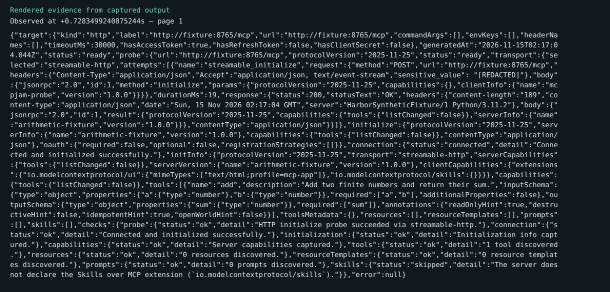

## 16149a18330644a0bc999e9b07a10cf8

Exit: `0`. Complete: `True`.

[Metadata](commands/0007-16149a18330644a0bc999e9b07a10cf8/event.json) · [stdout](commands/0007-16149a18330644a0bc999e9b07a10cf8/stdout.txt) · [stderr](commands/0007-16149a18330644a0bc999e9b07a10cf8/stderr.txt) · [ordered recording](commands/0007-16149a18330644a0bc999e9b07a10cf8/stream.jsonl)

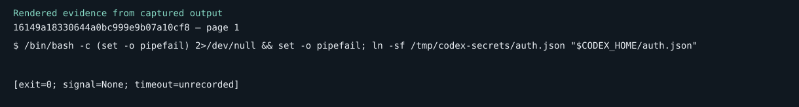

## 18adbd33f8574f97a0f3d5f8d00230b1

Exit: `0`. Complete: `True`.

[Metadata](commands/0008-18adbd33f8574f97a0f3d5f8d00230b1/event.json) · [stdout](commands/0008-18adbd33f8574f97a0f3d5f8d00230b1/stdout.txt) · [stderr](commands/0008-18adbd33f8574f97a0f3d5f8d00230b1/stderr.txt) · [ordered recording](commands/0008-18adbd33f8574f97a0f3d5f8d00230b1/stream.jsonl)

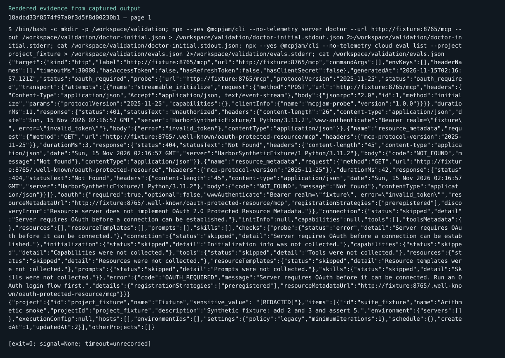

## 1ed604ac6199408ab9b65385ef8e1882

Exit: `0`. Complete: `True`.

[Metadata](commands/0009-1ed604ac6199408ab9b65385ef8e1882/event.json) · [stdout](commands/0009-1ed604ac6199408ab9b65385ef8e1882/stdout.txt) · [stderr](commands/0009-1ed604ac6199408ab9b65385ef8e1882/stderr.txt) · [ordered recording](commands/0009-1ed604ac6199408ab9b65385ef8e1882/stream.jsonl)

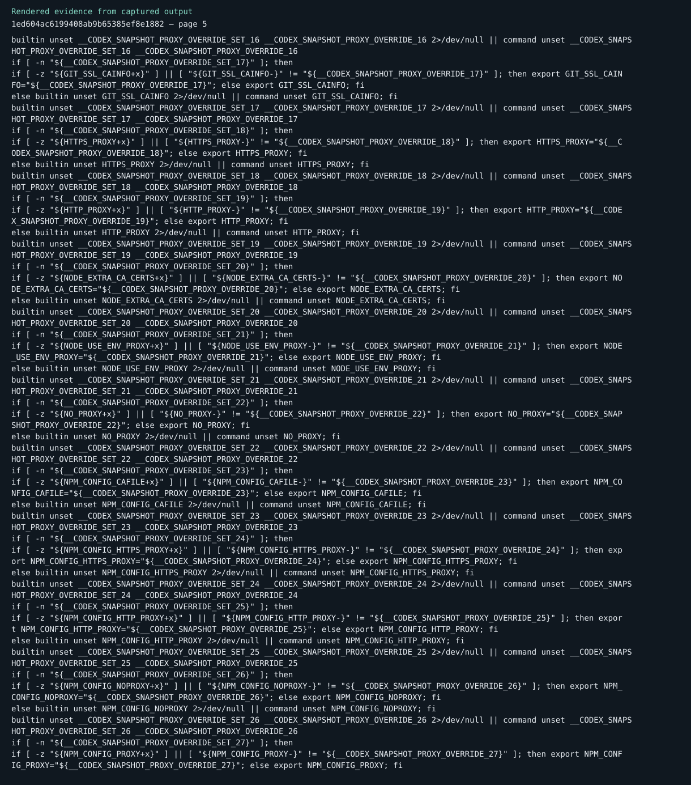

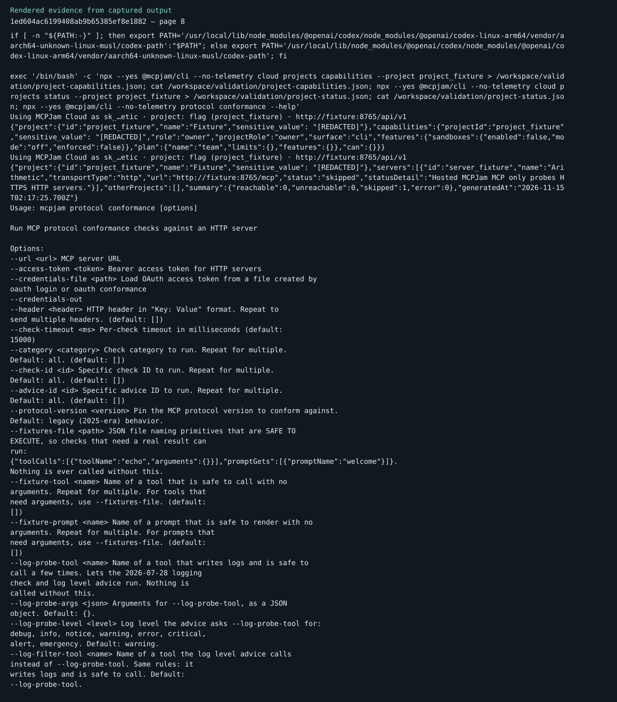
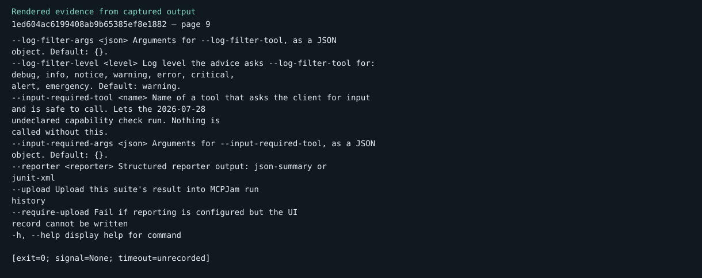
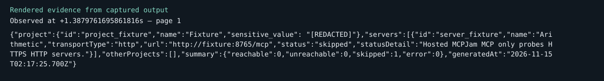
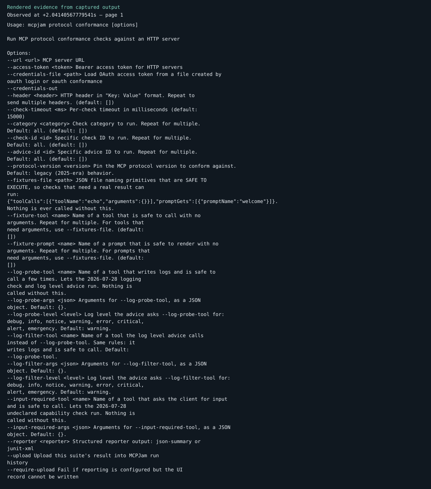
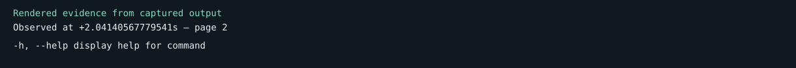

## 2167920544314ac0b13dde0e62a50557

Exit: `0`. Complete: `True`.

[Metadata](commands/0010-2167920544314ac0b13dde0e62a50557/event.json) · [stdout](commands/0010-2167920544314ac0b13dde0e62a50557/stdout.txt) · [stderr](commands/0010-2167920544314ac0b13dde0e62a50557/stderr.txt) · [ordered recording](commands/0010-2167920544314ac0b13dde0e62a50557/stream.jsonl)

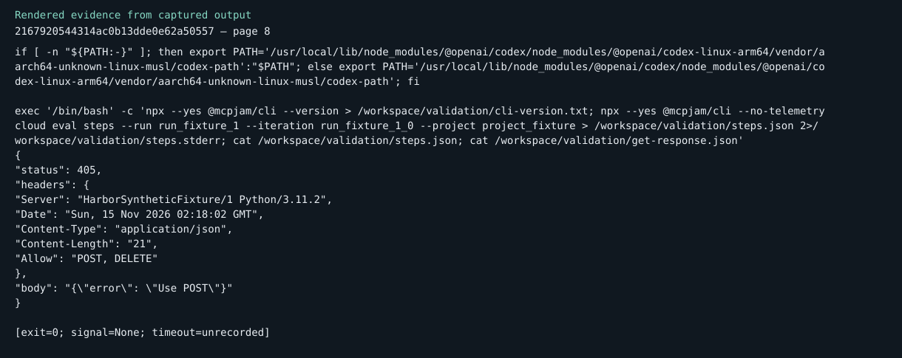
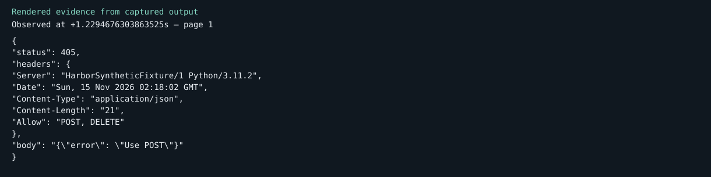

## 281745e2da9349b08150d160dde71257

Exit: `0`. Complete: `True`.

[Metadata](commands/0011-281745e2da9349b08150d160dde71257/event.json) · [stdout](commands/0011-281745e2da9349b08150d160dde71257/stdout.txt) · [stderr](commands/0011-281745e2da9349b08150d160dde71257/stderr.txt) · [ordered recording](commands/0011-281745e2da9349b08150d160dde71257/stream.jsonl)

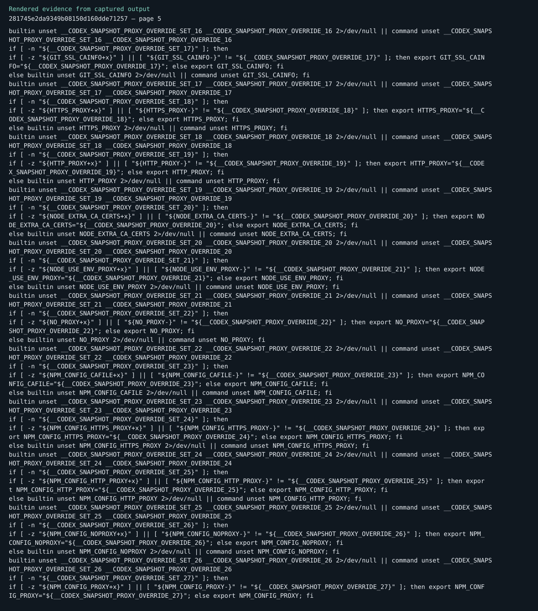

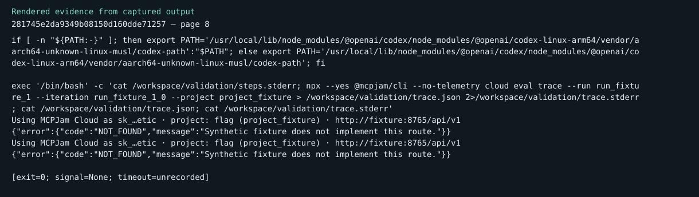
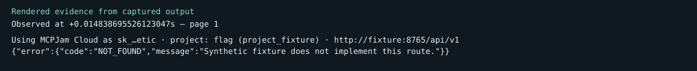

## 2db3f865669c4cf296846c6526587f39

Exit: `0`. Complete: `True`.

[Metadata](commands/0012-2db3f865669c4cf296846c6526587f39/event.json) · [stdout](commands/0012-2db3f865669c4cf296846c6526587f39/stdout.txt) · [stderr](commands/0012-2db3f865669c4cf296846c6526587f39/stderr.txt) · [ordered recording](commands/0012-2db3f865669c4cf296846c6526587f39/stream.jsonl)

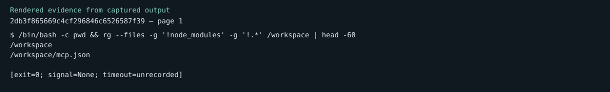

## 2ea974fcb8f6499889b02d85db2f30c8

Exit: `1`. Complete: `True`.

[Metadata](commands/0013-2ea974fcb8f6499889b02d85db2f30c8/event.json) · [stdout](commands/0013-2ea974fcb8f6499889b02d85db2f30c8/stdout.txt) · [stderr](commands/0013-2ea974fcb8f6499889b02d85db2f30c8/stderr.txt) · [ordered recording](commands/0013-2ea974fcb8f6499889b02d85db2f30c8/stream.jsonl)

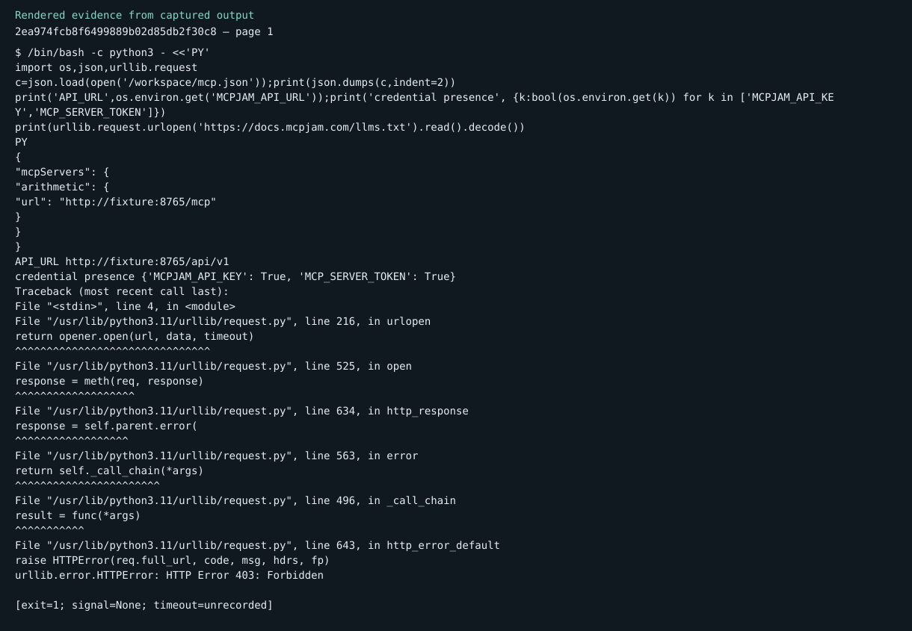
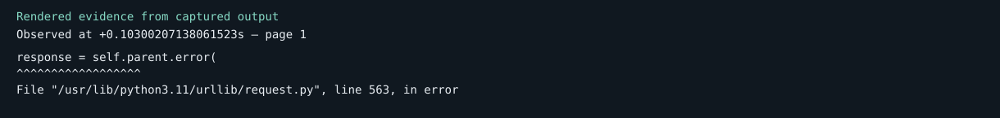

## 30266fd1110d442ab31d429e53b8a83d

Exit: `0`. Complete: `True`.

[Metadata](commands/0014-30266fd1110d442ab31d429e53b8a83d/event.json) · [stdout](commands/0014-30266fd1110d442ab31d429e53b8a83d/stdout.txt) · [stderr](commands/0014-30266fd1110d442ab31d429e53b8a83d/stderr.txt) · [ordered recording](commands/0014-30266fd1110d442ab31d429e53b8a83d/stream.jsonl)

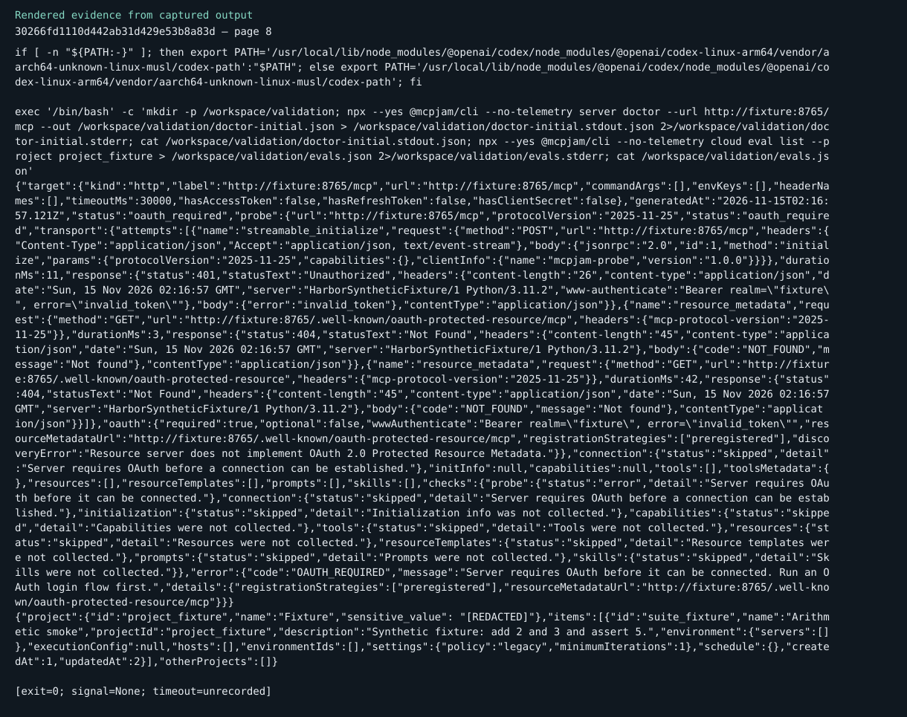
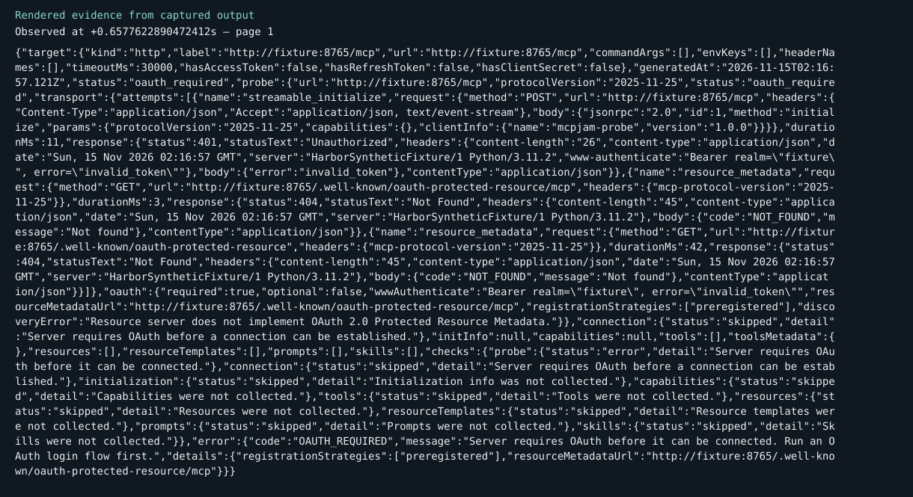

## 36356da19731427ca12bf6b2141d53cd

Exit: `0`. Complete: `True`.

[Metadata](commands/0015-36356da19731427ca12bf6b2141d53cd/event.json) · [stdout](commands/0015-36356da19731427ca12bf6b2141d53cd/stdout.txt) · [stderr](commands/0015-36356da19731427ca12bf6b2141d53cd/stderr.txt) · [ordered recording](commands/0015-36356da19731427ca12bf6b2141d53cd/stream.jsonl)

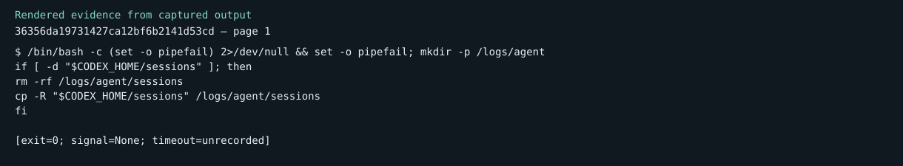

## 41c595826f1043618c1901904ba9c7b7

Exit: `0`. Complete: `True`.

[Metadata](commands/0016-41c595826f1043618c1901904ba9c7b7/event.json) · [stdout](commands/0016-41c595826f1043618c1901904ba9c7b7/stdout.txt) · [stderr](commands/0016-41c595826f1043618c1901904ba9c7b7/stderr.txt) · [ordered recording](commands/0016-41c595826f1043618c1901904ba9c7b7/stream.jsonl)

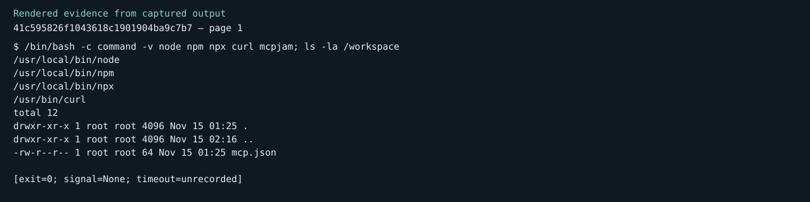

## 494f4196e1b84eb08b5dddb2bdcd834c

Exit: `0`. Complete: `True`.

[Metadata](commands/0017-494f4196e1b84eb08b5dddb2bdcd834c/event.json) · [stdout](commands/0017-494f4196e1b84eb08b5dddb2bdcd834c/stdout.txt) · [stderr](commands/0017-494f4196e1b84eb08b5dddb2bdcd834c/stderr.txt) · [ordered recording](commands/0017-494f4196e1b84eb08b5dddb2bdcd834c/stream.jsonl)

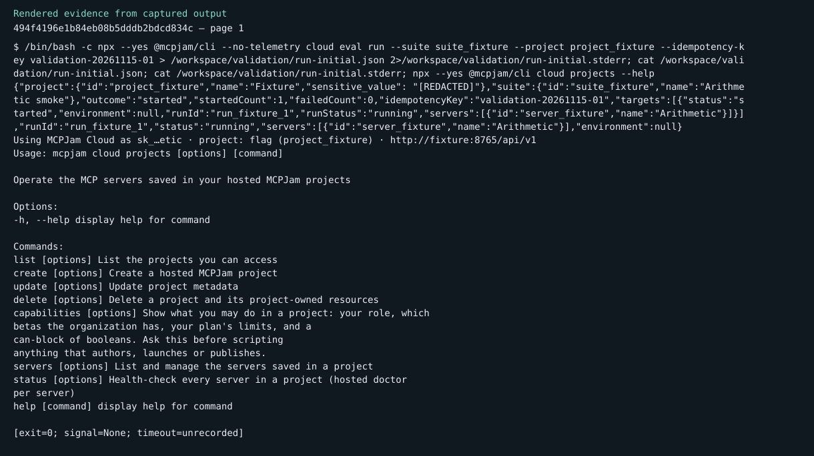

## 4caa7eee610d4d5582e79f80506da13d

Exit: `0`. Complete: `True`.

[Metadata](commands/0018-4caa7eee610d4d5582e79f80506da13d/event.json) · [stdout](commands/0018-4caa7eee610d4d5582e79f80506da13d/stdout.txt) · [stderr](commands/0018-4caa7eee610d4d5582e79f80506da13d/stderr.txt) · [ordered recording](commands/0018-4caa7eee610d4d5582e79f80506da13d/stream.jsonl)

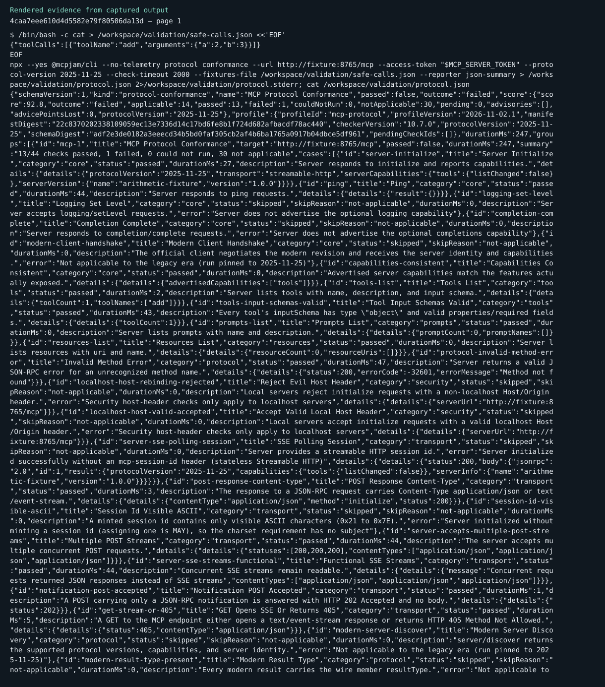
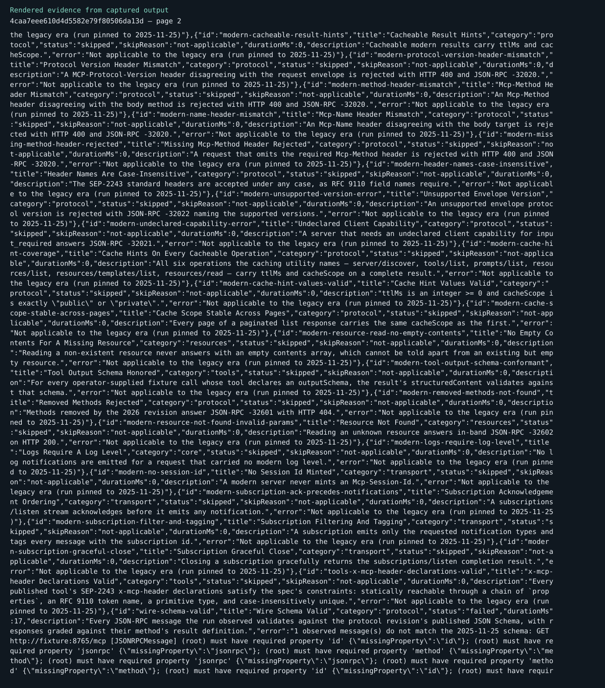
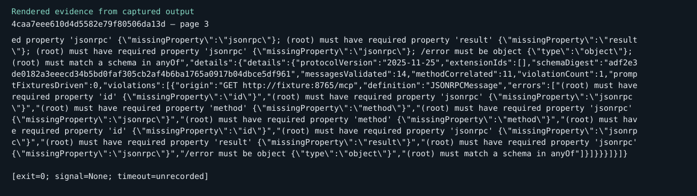
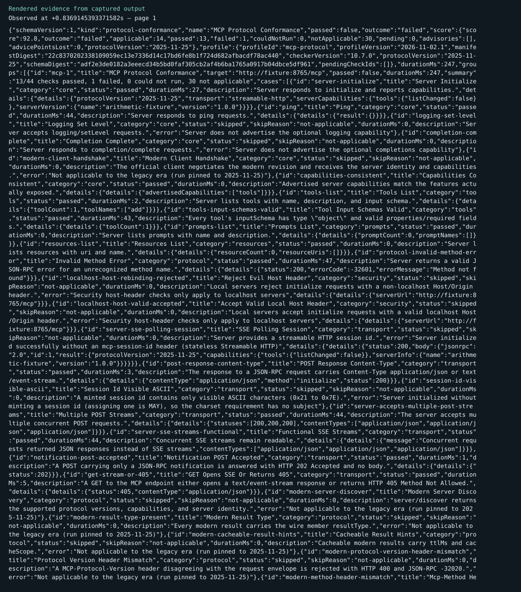

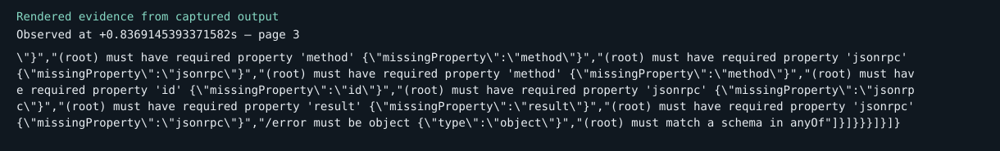

## 513c96246c5f4b08ba6654f20377d68d

Exit: `0`. Complete: `True`.

[Metadata](commands/0019-513c96246c5f4b08ba6654f20377d68d/event.json) · [stdout](commands/0019-513c96246c5f4b08ba6654f20377d68d/stdout.txt) · [stderr](commands/0019-513c96246c5f4b08ba6654f20377d68d/stderr.txt) · [ordered recording](commands/0019-513c96246c5f4b08ba6654f20377d68d/stream.jsonl)

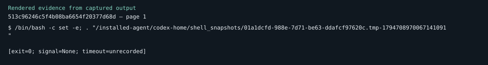

## 54275a8538a64882955d8561cbba00e5

Exit: `0`. Complete: `True`.

[Metadata](commands/0020-54275a8538a64882955d8561cbba00e5/event.json) · [stdout](commands/0020-54275a8538a64882955d8561cbba00e5/stdout.txt) · [stderr](commands/0020-54275a8538a64882955d8561cbba00e5/stderr.txt) · [ordered recording](commands/0020-54275a8538a64882955d8561cbba00e5/stream.jsonl)

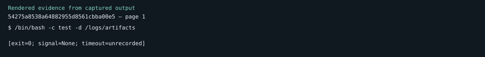

## 5cba3e478c824efa830f404573b2f6f0

Exit: `0`. Complete: `True`.

[Metadata](commands/0021-5cba3e478c824efa830f404573b2f6f0/event.json) · [stdout](commands/0021-5cba3e478c824efa830f404573b2f6f0/stdout.txt) · [stderr](commands/0021-5cba3e478c824efa830f404573b2f6f0/stderr.txt) · [ordered recording](commands/0021-5cba3e478c824efa830f404573b2f6f0/stream.jsonl)

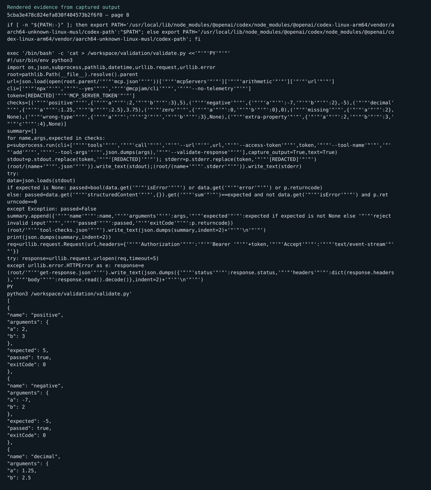
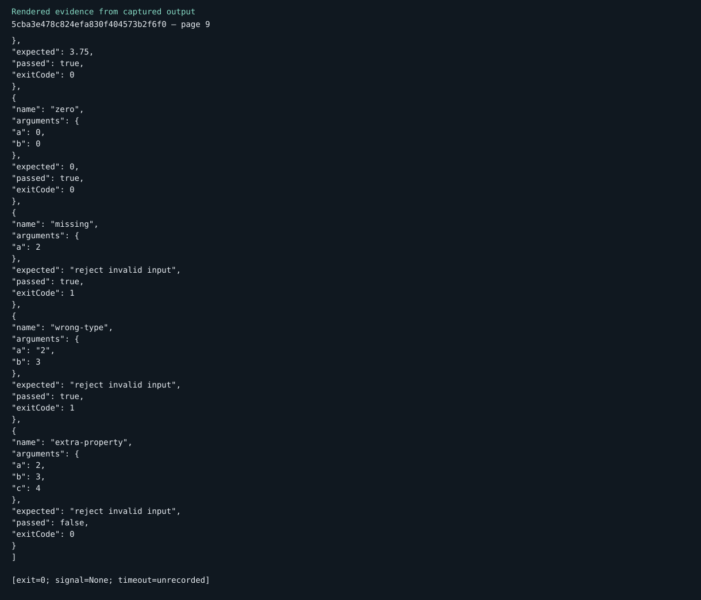

## 5d4884bd2da84e07a56676e38583c214

Exit: `0`. Complete: `True`.

[Metadata](commands/0022-5d4884bd2da84e07a56676e38583c214/event.json) · [stdout](commands/0022-5d4884bd2da84e07a56676e38583c214/stdout.txt) · [stderr](commands/0022-5d4884bd2da84e07a56676e38583c214/stderr.txt) · [ordered recording](commands/0022-5d4884bd2da84e07a56676e38583c214/stream.jsonl)

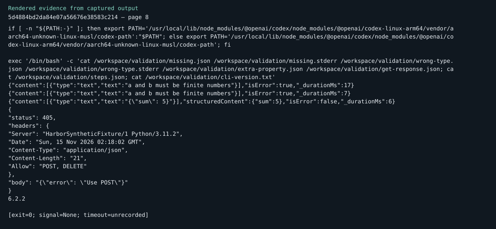
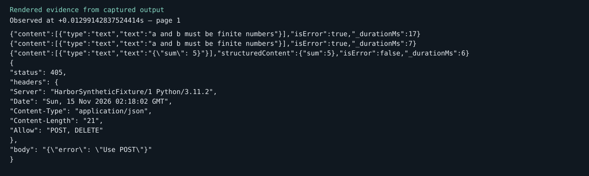

## 7c71a438d53540e79bd3f27ed677fa60

Exit: `0`. Complete: `True`.

[Metadata](commands/0023-7c71a438d53540e79bd3f27ed677fa60/event.json) · [stdout](commands/0023-7c71a438d53540e79bd3f27ed677fa60/stdout.txt) · [stderr](commands/0023-7c71a438d53540e79bd3f27ed677fa60/stderr.txt) · [ordered recording](commands/0023-7c71a438d53540e79bd3f27ed677fa60/stream.jsonl)

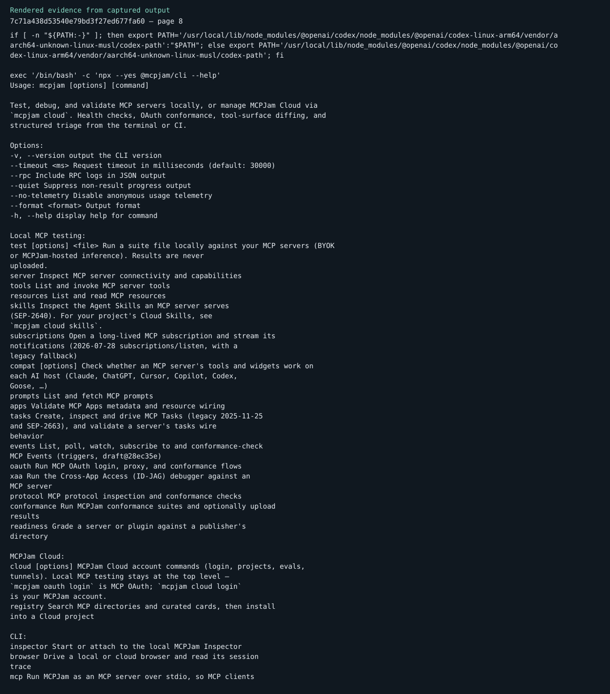
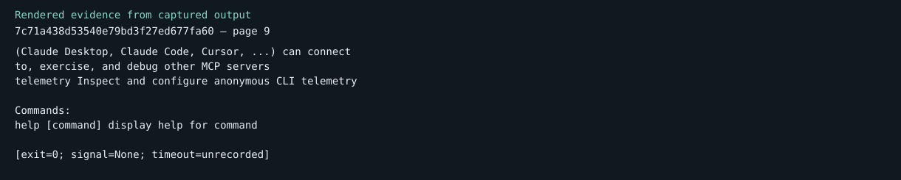

## 87b3cf38423645299aa4f2866b3b2a61

Exit: `0`. Complete: `True`.

[Metadata](commands/0024-87b3cf38423645299aa4f2866b3b2a61/event.json) · [stdout](commands/0024-87b3cf38423645299aa4f2866b3b2a61/stdout.txt) · [stderr](commands/0024-87b3cf38423645299aa4f2866b3b2a61/stderr.txt) · [ordered recording](commands/0024-87b3cf38423645299aa4f2866b3b2a61/stream.jsonl)

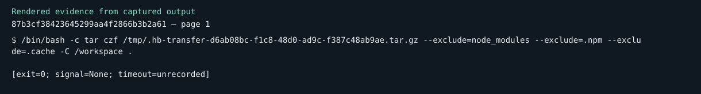

## 8e1c7bc04d8c4d57915d5c12c435824a

Exit: `0`. Complete: `True`.

[Metadata](commands/0025-8e1c7bc04d8c4d57915d5c12c435824a/event.json) · [stdout](commands/0025-8e1c7bc04d8c4d57915d5c12c435824a/stdout.txt) · [stderr](commands/0025-8e1c7bc04d8c4d57915d5c12c435824a/stderr.txt) · [ordered recording](commands/0025-8e1c7bc04d8c4d57915d5c12c435824a/stream.jsonl)

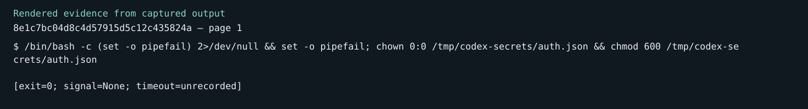

## 902afca4bd0643e99fa1cb80dd482af3

Exit: `0`. Complete: `True`.

[Metadata](commands/0026-902afca4bd0643e99fa1cb80dd482af3/event.json) · [stdout](commands/0026-902afca4bd0643e99fa1cb80dd482af3/stdout.txt) · [stderr](commands/0026-902afca4bd0643e99fa1cb80dd482af3/stderr.txt) · [ordered recording](commands/0026-902afca4bd0643e99fa1cb80dd482af3/stream.jsonl)

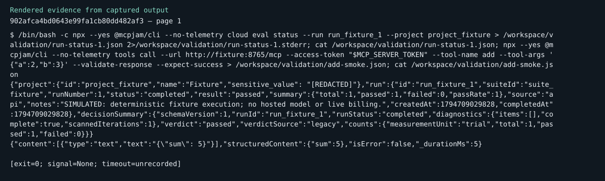

## 94389b039b32481ca3cb878915ae7777

Exit: `1`. Complete: `True`.

[Metadata](commands/0027-94389b039b32481ca3cb878915ae7777/event.json) · [stdout](commands/0027-94389b039b32481ca3cb878915ae7777/stdout.txt) · [stderr](commands/0027-94389b039b32481ca3cb878915ae7777/stderr.txt) · [ordered recording](commands/0027-94389b039b32481ca3cb878915ae7777/stream.jsonl)

## 98b4d60af93b441b9f71fdb6a5539d4e

Exit: `0`. Complete: `True`.

[Metadata](commands/0028-98b4d60af93b441b9f71fdb6a5539d4e/event.json) · [stdout](commands/0028-98b4d60af93b441b9f71fdb6a5539d4e/stdout.txt) · [stderr](commands/0028-98b4d60af93b441b9f71fdb6a5539d4e/stderr.txt) · [ordered recording](commands/0028-98b4d60af93b441b9f71fdb6a5539d4e/stream.jsonl)

## 9985763400ee42cfb4644095d37aa659

Exit: `0`. Complete: `True`.

[Metadata](commands/0029-9985763400ee42cfb4644095d37aa659/event.json) · [stdout](commands/0029-9985763400ee42cfb4644095d37aa659/stdout.txt) · [stderr](commands/0029-9985763400ee42cfb4644095d37aa659/stderr.txt) · [ordered recording](commands/0029-9985763400ee42cfb4644095d37aa659/stream.jsonl)

## 9fe9a8929b504034986359cce1c63f26

Exit: `0`. Complete: `True`.

[Metadata](commands/0030-9fe9a8929b504034986359cce1c63f26/event.json) · [stdout](commands/0030-9fe9a8929b504034986359cce1c63f26/stdout.txt) · [stderr](commands/0030-9fe9a8929b504034986359cce1c63f26/stderr.txt) · [ordered recording](commands/0030-9fe9a8929b504034986359cce1c63f26/stream.jsonl)

## a726c67bc14646c0bbdcedbc394bd56e

Exit: `0`. Complete: `True`.

[Metadata](commands/0031-a726c67bc14646c0bbdcedbc394bd56e/event.json) · [stdout](commands/0031-a726c67bc14646c0bbdcedbc394bd56e/stdout.txt) · [stderr](commands/0031-a726c67bc14646c0bbdcedbc394bd56e/stderr.txt) · [ordered recording](commands/0031-a726c67bc14646c0bbdcedbc394bd56e/stream.jsonl)

## a963990c537743f9b289b07a05144f91

Exit: `0`. Complete: `True`.

[Metadata](commands/0032-a963990c537743f9b289b07a05144f91/event.json) · [stdout](commands/0032-a963990c537743f9b289b07a05144f91/stdout.txt) · [stderr](commands/0032-a963990c537743f9b289b07a05144f91/stderr.txt) · [ordered recording](commands/0032-a963990c537743f9b289b07a05144f91/stream.jsonl)

## b4e45caa1ac1474cb772cf59f1e72b30

Exit: `0`. Complete: `True`.

[Metadata](commands/0033-b4e45caa1ac1474cb772cf59f1e72b30/event.json) · [stdout](commands/0033-b4e45caa1ac1474cb772cf59f1e72b30/stdout.txt) · [stderr](commands/0033-b4e45caa1ac1474cb772cf59f1e72b30/stderr.txt) · [ordered recording](commands/0033-b4e45caa1ac1474cb772cf59f1e72b30/stream.jsonl)

## b720244012db460abbdb7890e498e908

Exit: `0`. Complete: `True`.

[Metadata](commands/0034-b720244012db460abbdb7890e498e908/event.json) · [stdout](commands/0034-b720244012db460abbdb7890e498e908/stdout.txt) · [stderr](commands/0034-b720244012db460abbdb7890e498e908/stderr.txt) · [ordered recording](commands/0034-b720244012db460abbdb7890e498e908/stream.jsonl)

## bb54eb17ee0a44ddb41e8383acdb36a3

Exit: `127`. Complete: `True`.

[Metadata](commands/0035-bb54eb17ee0a44ddb41e8383acdb36a3/event.json) · [stdout](commands/0035-bb54eb17ee0a44ddb41e8383acdb36a3/stdout.txt) · [stderr](commands/0035-bb54eb17ee0a44ddb41e8383acdb36a3/stderr.txt) · [ordered recording](commands/0035-bb54eb17ee0a44ddb41e8383acdb36a3/stream.jsonl)

## bc3e3d8f528147c99980303b20f2bd84

Exit: `0`. Complete: `True`.

[Metadata](commands/0036-bc3e3d8f528147c99980303b20f2bd84/event.json) · [stdout](commands/0036-bc3e3d8f528147c99980303b20f2bd84/stdout.txt) · [stderr](commands/0036-bc3e3d8f528147c99980303b20f2bd84/stderr.txt) · [ordered recording](commands/0036-bc3e3d8f528147c99980303b20f2bd84/stream.jsonl)

## bca95abd18b54246b2c920f31a5793f3

Exit: `0`. Complete: `True`.

[Metadata](commands/0037-bca95abd18b54246b2c920f31a5793f3/event.json) · [stdout](commands/0037-bca95abd18b54246b2c920f31a5793f3/stdout.txt) · [stderr](commands/0037-bca95abd18b54246b2c920f31a5793f3/stderr.txt) · [ordered recording](commands/0037-bca95abd18b54246b2c920f31a5793f3/stream.jsonl)

## c1d497b2c86446d08051f006886e6bd9

Exit: `0`. Complete: `True`.

[Metadata](commands/0038-c1d497b2c86446d08051f006886e6bd9/event.json) · [stdout](commands/0038-c1d497b2c86446d08051f006886e6bd9/stdout.txt) · [stderr](commands/0038-c1d497b2c86446d08051f006886e6bd9/stderr.txt) · [ordered recording](commands/0038-c1d497b2c86446d08051f006886e6bd9/stream.jsonl)

## c42d614e1dd2487fbf5a9927752cc24c

Exit: `0`. Complete: `True`.

[Metadata](commands/0039-c42d614e1dd2487fbf5a9927752cc24c/event.json) · [stdout](commands/0039-c42d614e1dd2487fbf5a9927752cc24c/stdout.txt) · [stderr](commands/0039-c42d614e1dd2487fbf5a9927752cc24c/stderr.txt) · [ordered recording](commands/0039-c42d614e1dd2487fbf5a9927752cc24c/stream.jsonl)

## c5352dae227147e3b84cff83a2ff2115

Exit: `0`. Complete: `True`.

[Metadata](commands/0040-c5352dae227147e3b84cff83a2ff2115/event.json) · [stdout](commands/0040-c5352dae227147e3b84cff83a2ff2115/stdout.txt) · [stderr](commands/0040-c5352dae227147e3b84cff83a2ff2115/stderr.txt) · [ordered recording](commands/0040-c5352dae227147e3b84cff83a2ff2115/stream.jsonl)

## c8ec2f20f9234c9f89239d604ea6a2e4

Exit: `0`. Complete: `True`.

[Metadata](commands/0041-c8ec2f20f9234c9f89239d604ea6a2e4/event.json) · [stdout](commands/0041-c8ec2f20f9234c9f89239d604ea6a2e4/stdout.txt) · [stderr](commands/0041-c8ec2f20f9234c9f89239d604ea6a2e4/stderr.txt) · [ordered recording](commands/0041-c8ec2f20f9234c9f89239d604ea6a2e4/stream.jsonl)

## d0dd2fa6a7624add835230a367276696

Exit: `0`. Complete: `True`.

[Metadata](commands/0042-d0dd2fa6a7624add835230a367276696/event.json) · [stdout](commands/0042-d0dd2fa6a7624add835230a367276696/stdout.txt) · [stderr](commands/0042-d0dd2fa6a7624add835230a367276696/stderr.txt) · [ordered recording](commands/0042-d0dd2fa6a7624add835230a367276696/stream.jsonl)

## d4a05ec5db6c4e9f81d31977e102aee5

Exit: `1`. Complete: `True`.

[Metadata](commands/0043-d4a05ec5db6c4e9f81d31977e102aee5/event.json) · [stdout](commands/0043-d4a05ec5db6c4e9f81d31977e102aee5/stdout.txt) · [stderr](commands/0043-d4a05ec5db6c4e9f81d31977e102aee5/stderr.txt) · [ordered recording](commands/0043-d4a05ec5db6c4e9f81d31977e102aee5/stream.jsonl)

## d5c40d315f5a48e5bc2e4d105c625e09

Exit: `0`. Complete: `True`.

[Metadata](commands/0044-d5c40d315f5a48e5bc2e4d105c625e09/event.json) · [stdout](commands/0044-d5c40d315f5a48e5bc2e4d105c625e09/stdout.txt) · [stderr](commands/0044-d5c40d315f5a48e5bc2e4d105c625e09/stderr.txt) · [ordered recording](commands/0044-d5c40d315f5a48e5bc2e4d105c625e09/stream.jsonl)

## e633e3841470486c8df875265cad41ec

Exit: `0`. Complete: `True`.

[Metadata](commands/0045-e633e3841470486c8df875265cad41ec/event.json) · [stdout](commands/0045-e633e3841470486c8df875265cad41ec/stdout.txt) · [stderr](commands/0045-e633e3841470486c8df875265cad41ec/stderr.txt) · [ordered recording](commands/0045-e633e3841470486c8df875265cad41ec/stream.jsonl)

## e70a908c056a4428ae9de2a654328548

Exit: `0`. Complete: `True`.

[Metadata](commands/0046-e70a908c056a4428ae9de2a654328548/event.json) · [stdout](commands/0046-e70a908c056a4428ae9de2a654328548/stdout.txt) · [stderr](commands/0046-e70a908c056a4428ae9de2a654328548/stderr.txt) · [ordered recording](commands/0046-e70a908c056a4428ae9de2a654328548/stream.jsonl)

## e890113387c043e2af25a7e707fec431

Exit: `0`. Complete: `True`.

[Metadata](commands/0047-e890113387c043e2af25a7e707fec431/event.json) · [stdout](commands/0047-e890113387c043e2af25a7e707fec431/stdout.txt) · [stderr](commands/0047-e890113387c043e2af25a7e707fec431/stderr.txt) · [ordered recording](commands/0047-e890113387c043e2af25a7e707fec431/stream.jsonl)

## eae53d6181ba4dd7bc2a91bf21dfed08

Exit: `127`. Complete: `True`.

[Metadata](commands/0048-eae53d6181ba4dd7bc2a91bf21dfed08/event.json) · [stdout](commands/0048-eae53d6181ba4dd7bc2a91bf21dfed08/stdout.txt) · [stderr](commands/0048-eae53d6181ba4dd7bc2a91bf21dfed08/stderr.txt) · [ordered recording](commands/0048-eae53d6181ba4dd7bc2a91bf21dfed08/stream.jsonl)

## ef457f2080a348a79a23a5049b1f5ddf

Exit: `0`. Complete: `True`.

[Metadata](commands/0049-ef457f2080a348a79a23a5049b1f5ddf/event.json) · [stdout](commands/0049-ef457f2080a348a79a23a5049b1f5ddf/stdout.txt) · [stderr](commands/0049-ef457f2080a348a79a23a5049b1f5ddf/stderr.txt) · [ordered recording](commands/0049-ef457f2080a348a79a23a5049b1f5ddf/stream.jsonl)

## f44b0c06d34641929ff5ddb1e9d493b0

Exit: `0`. Complete: `True`.

[Metadata](commands/0050-f44b0c06d34641929ff5ddb1e9d493b0/event.json) · [stdout](commands/0050-f44b0c06d34641929ff5ddb1e9d493b0/stdout.txt) · [stderr](commands/0050-f44b0c06d34641929ff5ddb1e9d493b0/stderr.txt) · [ordered recording](commands/0050-f44b0c06d34641929ff5ddb1e9d493b0/stream.jsonl)

## f5f15bddc53d450bb04e3ba3f02a3a2b

Exit: `0`. Complete: `True`.

[Metadata](commands/0051-f5f15bddc53d450bb04e3ba3f02a3a2b/event.json) · [stdout](commands/0051-f5f15bddc53d450bb04e3ba3f02a3a2b/stdout.txt) · [stderr](commands/0051-f5f15bddc53d450bb04e3ba3f02a3a2b/stderr.txt) · [ordered recording](commands/0051-f5f15bddc53d450bb04e3ba3f02a3a2b/stream.jsonl)

## f6410ee38a9b4cb28188a6ca3bbdfa91

Exit: `0`. Complete: `True`.

[Metadata](commands/0052-f6410ee38a9b4cb28188a6ca3bbdfa91/event.json) · [stdout](commands/0052-f6410ee38a9b4cb28188a6ca3bbdfa91/stdout.txt) · [stderr](commands/0052-f6410ee38a9b4cb28188a6ca3bbdfa91/stderr.txt) · [ordered recording](commands/0052-f6410ee38a9b4cb28188a6ca3bbdfa91/stream.jsonl)

## f8eeecdd57e141379e6deaa080410124

Exit: `0`. Complete: `True`.

[Metadata](commands/0053-f8eeecdd57e141379e6deaa080410124/event.json) · [stdout](commands/0053-f8eeecdd57e141379e6deaa080410124/stdout.txt) · [stderr](commands/0053-f8eeecdd57e141379e6deaa080410124/stderr.txt) · [ordered recording](commands/0053-f8eeecdd57e141379e6deaa080410124/stream.jsonl)

## fb2ac2ffbce9460698d048f92c0a5f15

Exit: `0`. Complete: `True`.

[Metadata](commands/0054-fb2ac2ffbce9460698d048f92c0a5f15/event.json) · [stdout](commands/0054-fb2ac2ffbce9460698d048f92c0a5f15/stdout.txt) · [stderr](commands/0054-fb2ac2ffbce9460698d048f92c0a5f15/stderr.txt) · [ordered recording](commands/0054-fb2ac2ffbce9460698d048f92c0a5f15/stream.jsonl)

## fc80f1ec556a4cc2a87358c73d5a766d

Exit: `0`. Complete: `True`.

[Metadata](commands/0055-fc80f1ec556a4cc2a87358c73d5a766d/event.json) · [stdout](commands/0055-fc80f1ec556a4cc2a87358c73d5a766d/stdout.txt) · [stderr](commands/0055-fc80f1ec556a4cc2a87358c73d5a766d/stderr.txt) · [ordered recording](commands/0055-fc80f1ec556a4cc2a87358c73d5a766d/stream.jsonl)

## fc97e83045b54794a4e4716c5a576e95

Exit: `0`. Complete: `True`.

[Metadata](commands/0056-fc97e83045b54794a4e4716c5a576e95/event.json) · [stdout](commands/0056-fc97e83045b54794a4e4716c5a576e95/stdout.txt) · [stderr](commands/0056-fc97e83045b54794a4e4716c5a576e95/stderr.txt) · [ordered recording](commands/0056-fc97e83045b54794a4e4716c5a576e95/stream.jsonl)

