# patched-auth-v13--auth__UifmxRq

Outcome: **provider-blocked**. Concern notes: 0. Shell capture events: 10; actual agent shell invocations: 0.

[Results](result.json) · [Metrics](metrics.json) · [Concerns](concerns.jsonl) · [Agent tool invocations](agent-tool-invocations.json)

Capture events include nested wrapper shells and are not a user-command denominator. Legacy verifier `command_count` is also a capture-event count.

The outcome above reflects Harbor errors and the frozen strict reward. A zero reward alone does not establish a product failure.

## Public agent messages and tools

Private reasoning is omitted from these projections.

- [public-agent-claude-code.txt.jsonl](public-agent-claude-code.txt.jsonl)

## Collected artifacts

[Complete artifact inventory](artifact-inventory.json)

- [artifacts/fixture/state.json](artifacts/artifacts/fixture/state.json)
- [artifacts/workspace/mcp.json](artifacts/artifacts/workspace/mcp.json)

## 03f252d28f184bdaa4d41f1bf394b947

Exit: `0`. Complete: `True`.

[Metadata](commands/0001-03f252d28f184bdaa4d41f1bf394b947/event.json) · [stdout](commands/0001-03f252d28f184bdaa4d41f1bf394b947/stdout.txt) · [stderr](commands/0001-03f252d28f184bdaa4d41f1bf394b947/stderr.txt) · [ordered recording](commands/0001-03f252d28f184bdaa4d41f1bf394b947/stream.jsonl)

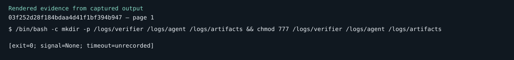

## 1f8d340c46f84895ab31f0cf9adfc93b

Exit: `0`. Complete: `True`.

[Metadata](commands/0002-1f8d340c46f84895ab31f0cf9adfc93b/event.json) · [stdout](commands/0002-1f8d340c46f84895ab31f0cf9adfc93b/stdout.txt) · [stderr](commands/0002-1f8d340c46f84895ab31f0cf9adfc93b/stderr.txt) · [ordered recording](commands/0002-1f8d340c46f84895ab31f0cf9adfc93b/stream.jsonl)

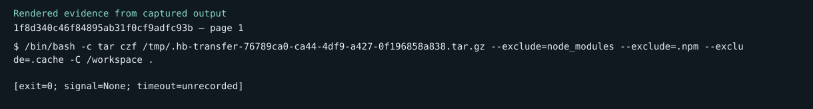

## 4e016f5a8c2a4612bb0f22b7c98b5afc

Exit: `0`. Complete: `True`.

[Metadata](commands/0003-4e016f5a8c2a4612bb0f22b7c98b5afc/event.json) · [stdout](commands/0003-4e016f5a8c2a4612bb0f22b7c98b5afc/stdout.txt) · [stderr](commands/0003-4e016f5a8c2a4612bb0f22b7c98b5afc/stderr.txt) · [ordered recording](commands/0003-4e016f5a8c2a4612bb0f22b7c98b5afc/stream.jsonl)

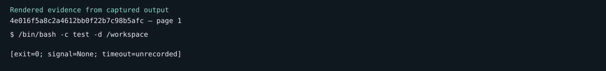

## 5a8361e829204e548129257eed4e2a45

Exit: `0`. Complete: `True`.

[Metadata](commands/0004-5a8361e829204e548129257eed4e2a45/event.json) · [stdout](commands/0004-5a8361e829204e548129257eed4e2a45/stdout.txt) · [stderr](commands/0004-5a8361e829204e548129257eed4e2a45/stderr.txt) · [ordered recording](commands/0004-5a8361e829204e548129257eed4e2a45/stream.jsonl)

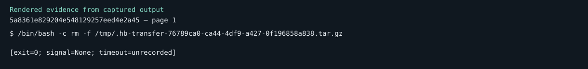

## 6bc69dd7da8748cba537086b95e522b8

Exit: `0`. Complete: `True`.

[Metadata](commands/0005-6bc69dd7da8748cba537086b95e522b8/event.json) · [stdout](commands/0005-6bc69dd7da8748cba537086b95e522b8/stdout.txt) · [stderr](commands/0005-6bc69dd7da8748cba537086b95e522b8/stderr.txt) · [ordered recording](commands/0005-6bc69dd7da8748cba537086b95e522b8/stream.jsonl)

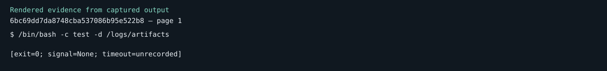

## 8627aa32ee1248b9a70bc30550834e65

Exit: `0`. Complete: `True`.

[Metadata](commands/0006-8627aa32ee1248b9a70bc30550834e65/event.json) · [stdout](commands/0006-8627aa32ee1248b9a70bc30550834e65/stdout.txt) · [stderr](commands/0006-8627aa32ee1248b9a70bc30550834e65/stderr.txt) · [ordered recording](commands/0006-8627aa32ee1248b9a70bc30550834e65/stream.jsonl)

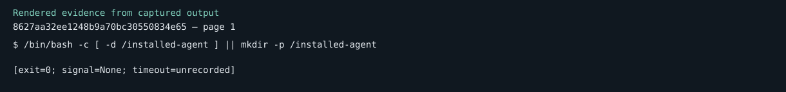

## 8fd19797d0c3424cbc043f6a1fe7f4c8

Exit: `0`. Complete: `True`.

[Metadata](commands/0007-8fd19797d0c3424cbc043f6a1fe7f4c8/event.json) · [stdout](commands/0007-8fd19797d0c3424cbc043f6a1fe7f4c8/stdout.txt) · [stderr](commands/0007-8fd19797d0c3424cbc043f6a1fe7f4c8/stderr.txt) · [ordered recording](commands/0007-8fd19797d0c3424cbc043f6a1fe7f4c8/stream.jsonl)

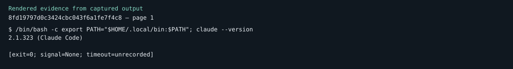

## a76d10669a454ec1b4283313c3a3be3a

Exit: `0`. Complete: `True`.

[Metadata](commands/0008-a76d10669a454ec1b4283313c3a3be3a/event.json) · [stdout](commands/0008-a76d10669a454ec1b4283313c3a3be3a/stdout.txt) · [stderr](commands/0008-a76d10669a454ec1b4283313c3a3be3a/stderr.txt) · [ordered recording](commands/0008-a76d10669a454ec1b4283313c3a3be3a/stream.jsonl)

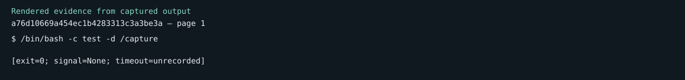

## c7245e3fb0c24b329eec434a987d3a83

Exit: `0`. Complete: `True`.

[Metadata](commands/0009-c7245e3fb0c24b329eec434a987d3a83/event.json) · [stdout](commands/0009-c7245e3fb0c24b329eec434a987d3a83/stdout.txt) · [stderr](commands/0009-c7245e3fb0c24b329eec434a987d3a83/stderr.txt) · [ordered recording](commands/0009-c7245e3fb0c24b329eec434a987d3a83/stream.jsonl)

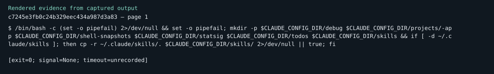

## c756a585cd614e7c83b56c2a65ff9203

Exit: `1`. Complete: `True`.

[Metadata](commands/0010-c756a585cd614e7c83b56c2a65ff9203/event.json) · [stdout](commands/0010-c756a585cd614e7c83b56c2a65ff9203/stdout.txt) · [stderr](commands/0010-c756a585cd614e7c83b56c2a65ff9203/stderr.txt) · [ordered recording](commands/0010-c756a585cd614e7c83b56c2a65ff9203/stream.jsonl)

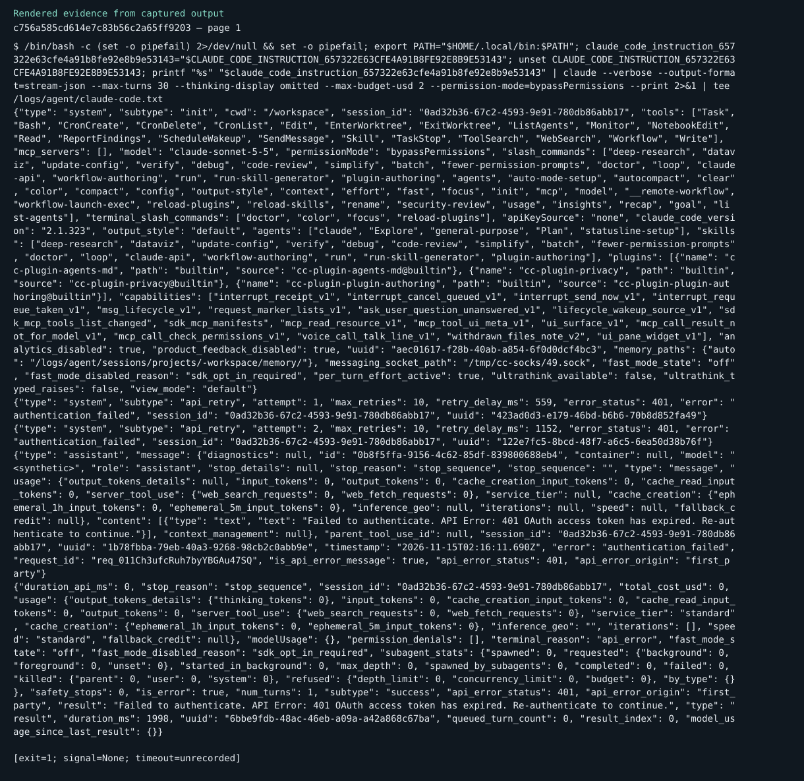
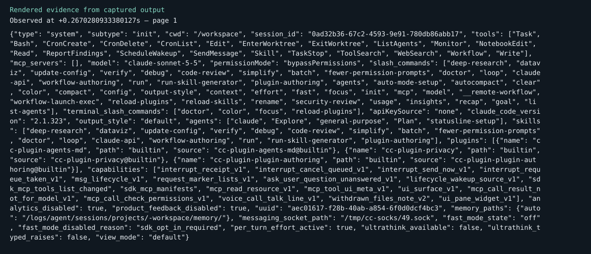
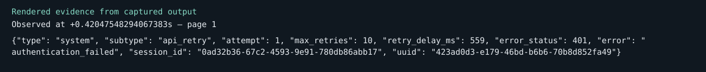
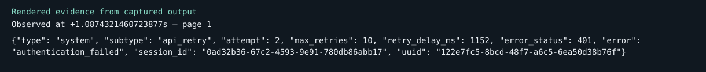
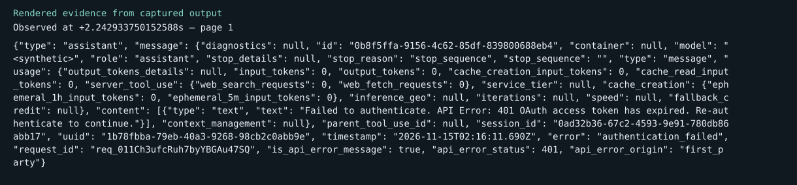
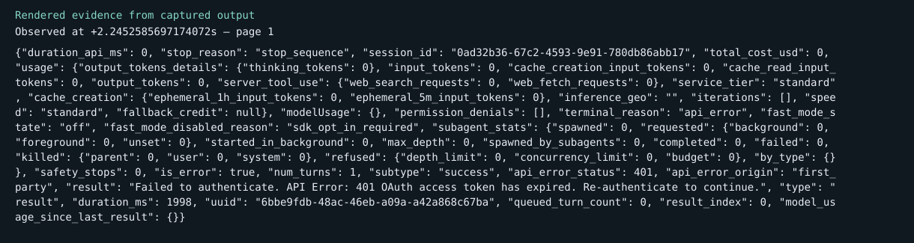
